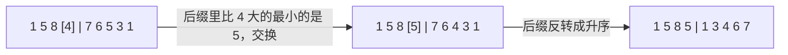

# 31. 下一个排列

> [力扣 31](https://leetcode.cn/problems/next-permutation/) · 近两年面经里出现在：**字节 ×2**
>
> A 层：所有常见解法都要会，闭卷写出，能讲清追问

## 识别信号

求字典序的「下一个」排列，原地修改。也是「下一个更大的数」（556 题）的核心。

## 解法一：找下降点 → 交换 → 反转后缀

**思路**：要让新排列比原来大、又尽量小，就要**改动的位置尽量靠右**。

1. **从后往前找第一个下降点** i：nums[i] < nums[i+1]。i 右边的后缀是降序的，已经是这些数能排出的最大值，不改 nums[i] 就不可能变大。
2. **在后缀里从右往左找第一个比 nums[i] 大的数** nums[j]，它是后缀里比 nums[i] 大的数中最小的。交换 nums[i] 和 nums[j]。交换后后缀仍然是降序。
3. **把后缀反转成升序**，让后缀最小。

如果找不到下降点（整个数组降序，已经是最大排列），i = −1，直接反转整个数组，得到最小排列。

<StepPlayer src="/viz/lc31.json" />

```python
def nextPermutation(nums):
    n = len(nums)
    i = n - 2
    while i >= 0 and nums[i] >= nums[i + 1]:   # 从后往前找第一个下降点
        i -= 1
    if i >= 0:
        j = n - 1
        while nums[j] <= nums[i]:              # 后缀里比 nums[i] 大的最小的数
            j -= 1
        nums[i], nums[j] = nums[j], nums[i]
    l, r = i + 1, n - 1                        # 后缀是降序的，反转成升序
    while l < r:
        nums[l], nums[r] = nums[r], nums[l]
        l += 1
        r -= 1
```

**复杂度**：时间 O(n)，空间 O(1)。

## 图解



## 易错点

- 两处比较都要带等号：`nums[i] >= nums[i+1]` 继续找、`nums[j] <= nums[i]` 继续找。不带等号，有重复元素时（`[1, 5, 1]`）会出错。
- 第 3 步是**反转**而不是排序：后缀本来就降序，反转就是 O(n) 的升序。
- 找不到下降点时也要反转，不要直接 return。

## 面试追问

- **上一个排列？** 把所有比较反过来：从后往前找第一个 nums[i] > nums[i+1]，在后缀里找比它小的最大的数，交换后反转。
- **下一个更大的数（556）？** 把整数转成数字数组跑一遍，最后检查是否超过 int 范围。
- **第 k 个排列（60）？** 不用跑 k 次，用阶乘逐位确定，见 [60](../10-backtracking/lc60)。
- **生成全部排列？** 从最小排列开始反复调用 next，直到回到最小（C++ 的 `next_permutation` 就是这么用的）；或者回溯，见 [46](../10-backtracking/lc46)、[47](../10-backtracking/lc47)。

## Java 版

```java
public void nextPermutation(int[] nums) {
    int n = nums.length, i = n - 2;
    while (i >= 0 && nums[i] >= nums[i + 1]) i--;
    if (i >= 0) {
        int j = n - 1;
        while (nums[j] <= nums[i]) j--;
        swap(nums, i, j);
    }
    for (int l = i + 1, r = n - 1; l < r; l++, r--) swap(nums, l, r);
}

private void swap(int[] a, int i, int j) {
    int t = a[i]; a[i] = a[j]; a[j] = t;
}
```

## 相关题

- [60. 排列序列](../10-backtracking/lc60)
- [46. 全排列](../10-backtracking/lc46)
- [556. 下一个更大元素 III](https://leetcode.cn/problems/next-greater-element-iii/)
