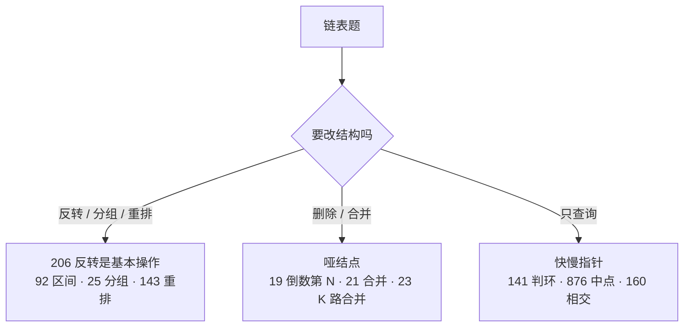

# 链表

## 核心框架

链表题靠三个技巧：

1. **画图**：先在纸上画出改指针前后的样子，标出每一步要改哪条 `next`。
2. **哑结点（dummy）**：头结点可能被删除或换掉时，在前面加一个哑结点，所有结点就都有前驱了，不用单独处理头。
3. **快慢指针**：找中点（快指针走两步）、判环（相遇）、倒数第 k 个（快指针先走 k 步）。

还有一条铁律：**改 `cur.next` 之前，先用变量存住原来的 `cur.next`。**

### 快慢指针的三个用法

| 用途 | 做法 | 结论 |
|---|---|---|
| 找中点 | `slow` 走一步，`fast` 走两步 | `fast` 到尾时 `slow` 在中点 |
| 判环 | 同上 | 有环必相遇 |
| 找入环点 | 相遇后把一个指针放回头部，两个都每次走一步 | 再次相遇的点就是入口（设头到入口 a，入口到相遇点 b，环长 c，则 a = (k−1)c + (c−b)） |
| 倒数第 k 个 | `fast` 先走 k 步，再一起走 | `fast` 到尾时 `slow` 是倒数第 k 个 |

<!-- 以下由 tools/gen_index.py 生成，不要手改 -->

## 核心题目

本章 21 题，已完成 8 题。层级和来源的含义见[核心 300 题](/core300)。

### A 层 · 面经高频（8 题）

| 题目 | 层级 | 难度 | 来源 | 近两年面经 | 完成 |
|---|---|---|---|---|---|
| [19. 删除链表的倒数第 N 个结点](./lc19) | A | 中等 | Hot 100 | 美团 · 招银 · 字节 | ✅ |
| [21. 合并两个有序链表](./lc21) | A | 简单 | Hot 100 | 字节 | ✅ |
| [23. 合并 K 个升序链表](./lc23) | A | 困难 | Hot 100 | 腾讯 | ✅ |
| [25. K 个一组翻转链表](./lc25) | A | 困难 | Hot 100 | 字节 ×3 · 美团 ×2 | ✅ |
| [92. 反转链表 II](./lc92) | A | 中等 | 面试经典 150 · 面经 | 美团 · 腾讯 WXG | ✅ |
| [141. 环形链表](./lc141) | A | 简单 | Hot 100 | 腾讯 · 字节 | ✅ |
| [143. 重排链表](./lc143) | A | 中等 | 面经 | 美团 ×3 | ✅ |
| [206. 反转链表](./lc206) | A | 简单 | Hot 100 | 字节 · 美团 · 小红书 | ✅ |

### B 层 · 必会（8 题）

| 题目 | 层级 | 难度 | 来源 | 近两年面经 | 完成 |
|---|---|---|---|---|---|
| [2. 两数相加](./lc2) | B | 中等 | Hot 100 |  |  |
| [24. 两两交换链表中的节点](./lc24) | B | 中等 | Hot 100 |  |  |
| [82. 删除排序链表中的重复元素 II](./lc82) | B | 中等 | 面试经典 150 |  |  |
| [138. 随机链表的复制](./lc138) | B | 中等 | Hot 100 |  |  |
| [142. 环形链表 II](./lc142) | B | 中等 | Hot 100 |  |  |
| [148. 排序链表](./lc148) | B | 中等 | Hot 100 | 高频经典 |  |
| [328. 奇偶链表](./lc328) | B | 中等 | 题型补强 |  |  |
| [445. 两数相加 II](./lc445) | B | 中等 | 题型补强 |  |  |

### C 层 · 认得题型（5 题）

| 题目 | 层级 | 难度 | 来源 | 近两年面经 | 完成 |
|---|---|---|---|---|---|
| [61. 旋转链表](./lc61) | C | 中等 | 面试经典 150 |  |  |
| [83. 删除排序链表中的重复元素](./lc83) | C | 简单 | 题型补强 |  |  |
| [86. 分隔链表](./lc86) | C | 中等 | 面试经典 150 |  |  |
| [160. 相交链表](./lc160) | C | 简单 | Hot 100 | 高频经典 |  |
| [234. 回文链表](./lc234) | C | 简单 | Hot 100 |  |  |
