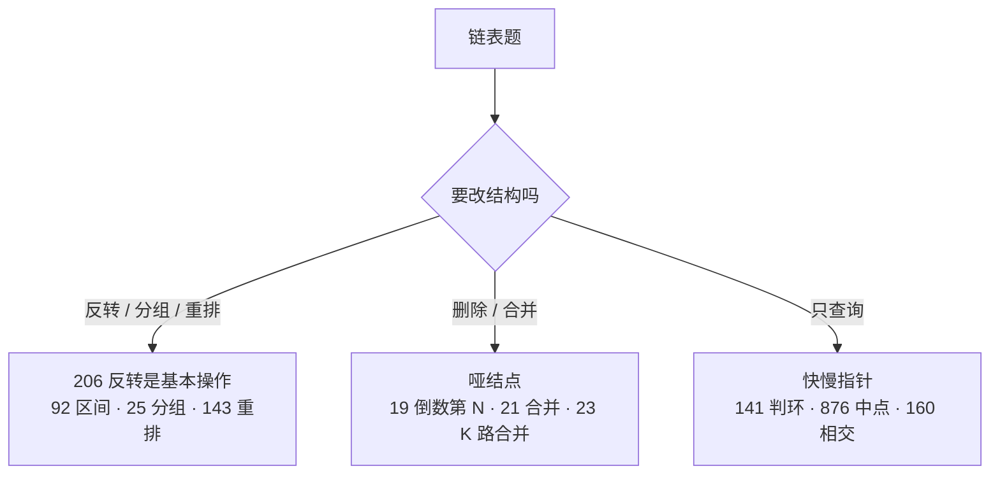

# 链表

## 核心框架

链表题靠三个技巧：

1. **画图**：先在纸上画出改指针前后的样子，标出每一步要改哪条 `next`。
2. **哑结点（dummy）**：头结点可能被删除或换掉时，在前面加一个哑结点，所有结点就都有前驱了，不用单独处理头。
3. **快慢指针**：找中点（快指针走两步）、判环（相遇）、倒数第 k 个（快指针先走 k 步）。

还有一条铁律：**改 `cur.next` 之前，先用变量存住原来的 `cur.next`。**

### 快慢指针的三个用法

| 用途 | 做法 | 结论 |
|---|---|---|
| 找中点 | `slow` 走一步，`fast` 走两步 | `fast` 到尾时 `slow` 在中点 |
| 判环 | 同上 | 有环必相遇 |
| 找入环点 | 相遇后把一个指针放回头部，两个都每次走一步 | 再次相遇的点就是入口（设头到入口 a，入口到相遇点 b，环长 c，则 a = (k−1)c + (c−b)） |
| 倒数第 k 个 | `fast` 先走 k 步，再一起走 | `fast` 到尾时 `slow` 是倒数第 k 个 |

## 核心题目

「近两年出现在」统计自 2025–2026 年的后端面经（见[说明](/#数据来源)）；「高频经典」表示这份样本里没出现，但属于 Hot 100 必会题。

| 题目 | 近两年出现在 | 要掌握的解法 | 状态 |
|---|---|---|---|
| [206. 反转链表](./lc206) | 字节 · 美团 · 小红书 | 迭代 / 递归 / 头插法 | ✅ 含动画 |
| [92. 反转链表 II](./lc92) | 美团 · 腾讯 WXG | 头插法一次遍历 / 截断反转接回 | |
| [25. K 个一组翻转链表](./lc25) | 字节 ×3 · 美团 ×2 | 迭代 / 递归 | ✅ 含动画 |
| [21. 合并两个有序链表](./lc21) | 字节 | 哑结点迭代 / 递归 | |
| [23. 合并 K 个升序链表](./lc23) | 腾讯 | 小顶堆 / 分治 | |
| [141. 环形链表 I / II](./lc141) | 腾讯 · 字节 | 哈希表 / 快慢指针 | |
| [19. 删除倒数第 N 个结点](./lc19) | 美团 · 招银 · 字节 | 两次遍历 / 快指针先走 | |
| [143. 重排链表](./lc143) | 美团 ×3 | 数组 / 中点 + 反转 + 合并 | |
| [160. 相交链表](./lc160) | 高频经典 | 哈希表 / 双指针 | |
| [148. 排序链表](./lc148) | 高频经典 | 自顶向下 / 自底向上归并 | |
