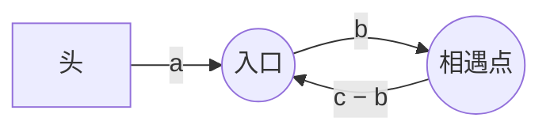

# 141. 环形链表

> [力扣 141](https://leetcode.cn/problems/linked-list-cycle/) · 简单 · 近两年面经：**腾讯 · 字节**（经常连着问 142 找入环点）
>
> A 层：所有常见解法都要会，闭卷写出，能讲清追问

## 识别信号

判断链表有没有环、找环的入口、求环的长度。只要题目要求 O(1) 空间，就是快慢指针。

## 解法一：哈希集合

**思路**：边走边把结点存进集合，遇到已经见过的结点就说明有环。注意存的是**结点对象**，不是结点的值（值可能重复）。

```python
def hasCycle(head):
    seen = set()
    while head:
        if head in seen:
            return True
        seen.add(head)
        head = head.next
    return False
```

**复杂度**：时间 O(n)，空间 O(n)。

## 解法二：快慢指针（Floyd 判圈）

**思路**：slow 每次走一步，fast 每次走两步。没有环时 fast 会先走到空；有环时两个指针都会进入环，在环里 fast 每次比 slow 多走一步，相当于以每次一步的速度追 slow，一定会追上，不会跳过。

```python
def hasCycle(head):
    slow = fast = head
    while fast and fast.next:
        slow, fast = slow.next, fast.next.next
        if slow is fast:
            return True
    return False
```

**复杂度**：时间 O(n)，空间 O(1)。

## 追问：142 找入环点

**思路**：相遇后，让一个指针回到头部，两个指针都每次走一步，再次相遇的地方就是入环点。

<StepPlayer src="/viz/lc142.json" />

```python
def detectCycle(head):
    slow = fast = head
    while fast and fast.next:
        slow, fast = slow.next, fast.next.next
        if slow is fast:
            p = head
            while p is not slow:
                p, slow = p.next, slow.next
            return p
    return None
```

**为什么这样能找到入口？** 设头到入口的距离为 a，入口到相遇点为 b，环长为 c。相遇时：

- slow 走了 a + b；
- fast 走了 a + b + k·c（多绕了 k 圈），并且 fast 走的是 slow 的两倍：2(a + b) = a + b + k·c。

所以 **a = k·c − b = (k − 1)·c + (c − b)**。c − b 正好是从相遇点继续走到入口的距离。于是一个指针从头走 a 步，另一个从相遇点走同样的步数，会在入口相遇。



## 易错点

- 循环条件要写 `fast and fast.next`，否则 `fast.next.next` 会空指针。
- 判断相遇要比较结点本身（`is` / `==` 引用），不是比较值。
- 142 里不能在相遇前就把 p 放回头部，必须先确认有环。

## 面试追问

- **怎么求环的长度？** 相遇后让一个指针在环里继续走，再回到相遇点时走过的步数就是环长。
- **fast 一次走三步行不行？** 也能判环，但相对速度变成 2，可能会跳过 slow 多绕几圈才相遇，而且找入口的公式不再成立。走两步是最简单的选择。
- **快慢指针还能用来做什么？** 找中点（[143 重排链表](./lc143)、[148 排序链表](./lc148)）、找倒数第 k 个（[19](./lc19)）、判断快乐数（202）、找重复数（[287](/01-array-two-pointers/lc287)，把数组看成链表）。

## Java 版

```java
public ListNode detectCycle(ListNode head) {
    ListNode slow = head, fast = head;
    while (fast != null && fast.next != null) {
        slow = slow.next;
        fast = fast.next.next;
        if (slow == fast) {
            ListNode p = head;
            while (p != slow) {
                p = p.next;
                slow = slow.next;
            }
            return p;
        }
    }
    return null;
}
```

## 相关题

- [142. 环形链表 II](./lc142)
- [287. 寻找重复数](/01-array-two-pointers/lc287)
- [160. 相交链表](./lc160)：同样是两个指针走相同的总路程
