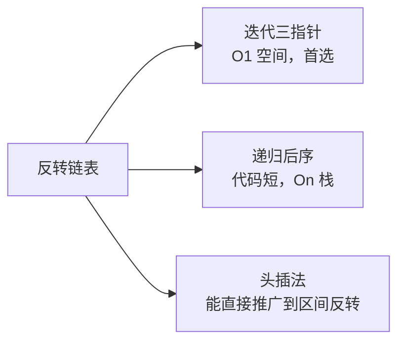

# 206. 反转链表

> [力扣 206](https://leetcode.cn/problemset/?search=206) · 近两年面经里出现在：**字节 · 美团 · 小红书**（小红书是压力面里连续手撕的第三题）

## 识别信号

所有「反转」「倒序」「两两交换」「K 个一组」的链表题，最后都要用到这道题的操作。面试官常常先让你写迭代，再追问「能写递归吗」。

## 解法一：迭代（三指针）

**思路**：从头到尾走一遍，把每个结点的 `next` 掉头指向前一个结点。改 `cur.next` 之前，必须先用 `nxt` 存住原来的下一个结点，否则链表就断了。

<StepPlayer src="/viz/lc206-iter.json" />

```python
def reverseList(head):
    prev, cur = None, head
    while cur:
        nxt = cur.next      # 1. 记住下一个
        cur.next = prev     # 2. 掉头
        prev, cur = cur, nxt  # 3. 两个指针一起前进
    return prev             # cur 为空时，prev 是新头
```

**复杂度**：时间 O(n)，空间 O(1)。

## 解法二：递归（后序）

**思路**：相信 `reverseList(head.next)` 已经把后面的部分反转好，并返回了新头。这时 `head.next` 还指着原来的第二个结点，而它现在是反转后那一段的**尾巴**，所以让它指回 `head`：`head.next.next = head`。最后把 `head.next` 置空，防止成环。

<StepPlayer src="/viz/lc206-rec.json" />

```python
def reverseList(head):
    if head is None or head.next is None:
        return head
    new_head = reverseList(head.next)
    head.next.next = head
    head.next = None
    return new_head
```

**复杂度**：时间 O(n)，空间 O(n)（递归栈）。链表很长时会栈溢出，Python 默认递归深度上限是 1000。

## 解法三：头插法（哑结点）

**思路**：新建一个哑结点 `dummy`，把原链表的结点依次摘下来，插到 `dummy` 后面。这种写法和 [92. 区间反转](./lc92) 的一次遍历解法完全一样，值得一起记。

```python
def reverseList(head):
    dummy = ListNode(0)
    cur = head
    while cur:
        nxt = cur.next
        cur.next = dummy.next   # 插到 dummy 后面
        dummy.next = cur
        cur = nxt
    return dummy.next
```

**复杂度**：时间 O(n)，空间 O(1)。

## 三种解法对比



## 易错点

- 忘记先存 `nxt`，导致链表断开。
- 递归版忘记 `head.next = None`，原来的头结点和第二个结点互相指向，形成环。
- 返回值写成 `cur`：循环结束时 `cur` 是空，新头是 `prev`。

## Java 版（面试官要求用主语言时）

```java
public ListNode reverseList(ListNode head) {
    ListNode prev = null, cur = head;
    while (cur != null) {
        ListNode nxt = cur.next;
        cur.next = prev;
        prev = cur;
        cur = nxt;
    }
    return prev;
}
```

## 相关题

- [92. 反转链表 II](./lc92)：只反转一段
- [25. K 个一组翻转链表](./lc25)：分组反转
- [143. 重排链表](./lc143)：找中点 + 反转后半 + 合并
