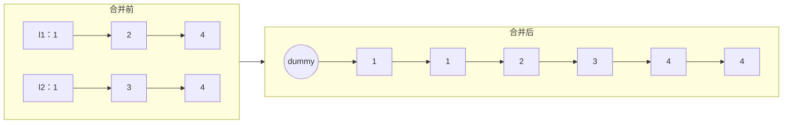

# 21. 合并两个有序链表

> [力扣 21](https://leetcode.cn/problems/merge-two-sorted-lists/) · 简单 · 近两年面经：**字节**
>
> A 层：所有常见解法都要会，闭卷写出，能讲清追问

## 识别信号

两个有序序列合并成一个。它是[归并排序](/00-sorting/merge-sort)的合并步骤，也是 [23. 合并 K 个升序链表](./lc23)、[148. 排序链表](./lc148) 的基础。

## 解法一：哑结点 + 迭代

**思路**：用一个哑结点 `dummy` 当新链表的头，`tail` 指向新链表的末尾。每次比较两个链表的头，把较小的接到 `tail` 后面。一个链表走完后，把另一个剩下的部分整个接上。



```python
def mergeTwoLists(l1, l2):
    dummy = tail = ListNode()
    while l1 and l2:
        if l1.val <= l2.val:          # 用 <= 保证稳定：相等时先取 l1
            tail.next, l1 = l1, l1.next
        else:
            tail.next, l2 = l2, l2.next
        tail = tail.next
    tail.next = l1 or l2              # 剩下的直接接上
    return dummy.next
```

**复杂度**：时间 O(m + n)，空间 O(1)。没有新建结点，只是改指针。

## 解法二：递归

**思路**：较小的那个头结点就是结果的头，它的 `next` 等于「剩下两部分合并的结果」。

```python
def mergeTwoLists(l1, l2):
    if not l1 or not l2:
        return l1 or l2
    if l1.val <= l2.val:
        l1.next = mergeTwoLists(l1.next, l2)
        return l1
    l2.next = mergeTwoLists(l1, l2.next)
    return l2
```

**复杂度**：时间 O(m + n)，空间 O(m + n)（递归栈）。链表很长时会栈溢出，面试时先写迭代版。

## 易错点

- 忘了最后把剩余部分接上。
- 没有哑结点时要单独处理头结点，代码会多很多分支。
- 用 `<` 而不是 `<=` 结果也对，但相等元素的相对顺序会变（不稳定）。归并排序要求稳定时要注意。

## 面试追问

- **合并 K 个怎么办？** 见 [23](./lc23)：小顶堆或分治两两合并，都是 O(N log k)。
- **两个有序数组合并呢？** 见 [88](/01-array-two-pointers/lc88)：从后往前合并，避免覆盖。
- **要求去重怎么改？** 接结点前和 `tail.val` 比较，相等就跳过。

## Java 版

```java
public ListNode mergeTwoLists(ListNode l1, ListNode l2) {
    ListNode dummy = new ListNode(0), tail = dummy;
    while (l1 != null && l2 != null) {
        if (l1.val <= l2.val) {
            tail.next = l1;
            l1 = l1.next;
        } else {
            tail.next = l2;
            l2 = l2.next;
        }
        tail = tail.next;
    }
    tail.next = (l1 != null) ? l1 : l2;
    return dummy.next;
}
```

## 相关题

- [23. 合并 K 个升序链表](./lc23)
- [88. 合并两个有序数组](/01-array-two-pointers/lc88)
- [148. 排序链表](./lc148)
