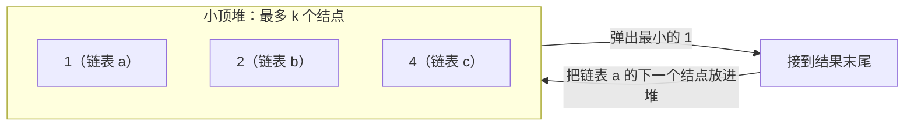

# 23. 合并 K 个升序链表

> [力扣 23](https://leetcode.cn/problems/merge-k-sorted-lists/) · 困难 · 近两年面经：**腾讯**（营销后端问的是「N 个升序数组合并」，思路完全一样）
>
> A 层：所有常见解法都要会，闭卷写出，能讲清追问

## 识别信号

多路有序序列合并成一个。在工程里也很常见：数据库分片查询结果合并、外部排序的多路归并、日志按时间合并。

设一共 N 个结点、k 个链表。

## 解法一：逐个合并

**思路**：用 [21](./lc21) 的方法，把第 1 个和第 2 个合并，结果再和第 3 个合并……

**复杂度**：时间 O(k·N)。前面的结点会被反复扫描，k 大时很慢。面试时先说这个思路，再说怎么优化。

## 解法二：小顶堆

**思路**：把每个链表的头放进小顶堆，每次弹出最小的接到结果后面，再把它的下一个结点放进堆。堆里最多 k 个元素。



```python
import heapq

def mergeKLists(lists):
    # 放入下标 i：值相等时 Python 会继续比较第二个元素，ListNode 不能比较大小
    h = [(node.val, i, node) for i, node in enumerate(lists) if node]
    heapq.heapify(h)
    dummy = tail = ListNode()
    while h:
        _, i, node = heapq.heappop(h)
        tail.next = tail = node
        if node.next:
            heapq.heappush(h, (node.next.val, i, node.next))
    return dummy.next
```

**复杂度**：时间 O(N log k)，空间 O(k)。

## 解法三：分治，两两合并

**思路**：像归并排序一样，第一轮把 k 个链表两两合并成 k/2 个，第二轮再两两合并……一共 log k 轮，每轮所有结点各被处理一次。

```python
def mergeKLists(lists):
    if not lists:
        return None
    step = 1
    while step < len(lists):
        for i in range(0, len(lists) - step, step * 2):
            lists[i] = mergeTwoLists(lists[i], lists[i + step])
        step *= 2
    return lists[0]
```

`mergeTwoLists` 见 [21](./lc21)。

**复杂度**：时间 O(N log k)，空间 O(1)（迭代写法；递归分治是 O(log k) 的栈）。

## 三种解法对比

| 解法 | 时间 | 空间 | 说明 |
|---|---|---|---|
| 逐个合并 | O(k·N) | O(1) | 先说出来，再优化 |
| 小顶堆 | O(N log k) | O(k) | 最常写，也适合「流式」数据：每个链表是一个数据流时也能用 |
| 分治 | O(N log k) | O(1) | 不需要额外的数据结构 |

## 易错点

- Python 的 `heapq` 里放 `(val, node)` 会在 val 相等时比较 node 而报错，要加下标 i 做第二关键字。
- Java 的 `PriorityQueue` 要传比较器：`(a, b) -> a.val - b.val`。值很大时相减可能溢出，更稳妥的是 `Integer.compare(a.val, b.val)`。
- 分治的循环边界：`range(0, len(lists) - step, step * 2)`，保证 `i + step` 不越界。

## 面试追问

- **N 个升序数组合并？** 一样用堆，堆里存 `(值, 数组编号, 下标)`。
- **数据太大放不进内存（外部排序）？** 每个有序文件读一小块进内存，用堆做多路归并，输出缓冲写满就写回磁盘，见[海量数据题](https://bingqin2.github.io/bagu-notes/11-distributed/massive-data)。
- **分库分表后多个分片的有序结果怎么合并？** 就是这道题：每个分片返回有序的前 n 条，用堆合并取前 n 条，见[深分页](https://bingqin2.github.io/bagu-notes/06-mysql/deep-pagination)。

## Java 版

```java
public ListNode mergeKLists(ListNode[] lists) {
    PriorityQueue<ListNode> pq = new PriorityQueue<>((a, b) -> Integer.compare(a.val, b.val));
    for (ListNode node : lists) if (node != null) pq.offer(node);
    ListNode dummy = new ListNode(0), tail = dummy;
    while (!pq.isEmpty()) {
        ListNode node = pq.poll();
        tail.next = node;
        tail = node;
        if (node.next != null) pq.offer(node.next);
    }
    return dummy.next;
}
```

## 相关题

- [21. 合并两个有序链表](./lc21)
- [148. 排序链表](./lc148)
- [378. 有序矩阵中第 K 小的元素](/06-heap-topk/lc378)：同样是多路归并
- [373. 查找和最小的 K 对数字](/06-heap-topk/lc373)
