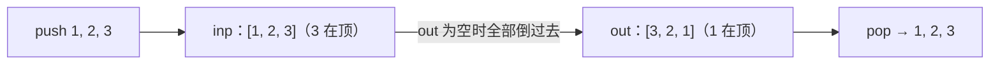

# 232. 用栈实现队列

> [力扣 232](https://leetcode.cn/problems/implement-queue-using-stacks/) · 近两年面经里出现在：**招银 · 字节**
>
> A 层：所有常见解法都要会，闭卷写出，能讲清追问

## 识别信号

用一种结构模拟另一种。栈是后进先出，倒一次顺序就反过来了，所以两个栈可以拼出先进先出。

## 解法一：输入栈 + 输出栈，均摊 O(1)

**思路**：

- `push` 只往输入栈 `inp` 里放。
- `pop` / `peek` 只从输出栈 `out` 拿。`out` 空的时候，把 `inp` 里的元素全部倒过去，顺序正好反转，`out` 的栈顶就是最早进来的元素。

```python
class MyQueue:
    def __init__(self):
        self.inp = []                      # 只负责 push
        self.out = []                      # 只负责 pop / peek，栈顶就是队头

    def push(self, x):
        self.inp.append(x)

    def _move(self):
        if not self.out:                   # 只有 out 空了才倒，否则顺序会乱
            while self.inp:
                self.out.append(self.inp.pop())

    def pop(self):
        self._move()
        return self.out.pop()

    def peek(self):
        self._move()
        return self.out[-1]

    def empty(self):
        return not self.inp and not self.out
```

**复杂度**：push O(1)；pop / peek **均摊** O(1)：每个元素最多被压入 inp 一次、从 inp 弹出一次、压入 out 一次、从 out 弹出一次。单次 pop 最坏 O(n)。

## 图解



## 易错点

- `out` 不为空时也去倒：新元素会压到老元素上面，顺序乱了。
- `empty` 要同时检查两个栈。

## 面试追问

- **反过来，用队列实现栈？** 见 [225](./lc225)：一个队列就够，push 后把前面的 n − 1 个元素依次出队再入队，新元素就到了队头。push O(n)，pop O(1)。
- **均摊分析怎么说？** 用「每个元素一生只经历 4 次操作」来论证，比势能法好讲。
- **多线程下？** 方法加锁，或者直接用 `ConcurrentLinkedQueue` / `ArrayBlockingQueue`。

## Java 版

```java
class MyQueue {
    private final Deque<Integer> in = new ArrayDeque<>();
    private final Deque<Integer> out = new ArrayDeque<>();

    public void push(int x) { in.push(x); }

    public int pop() {
        move();
        return out.pop();
    }

    public int peek() {
        move();
        return out.peek();
    }

    public boolean empty() { return in.isEmpty() && out.isEmpty(); }

    private void move() {
        if (out.isEmpty())                     // out 空了才倒
            while (!in.isEmpty()) out.push(in.pop());
    }
}
```

## 相关题

- [225. 用队列实现栈](./lc225)
- [155. 最小栈](./lc155)
