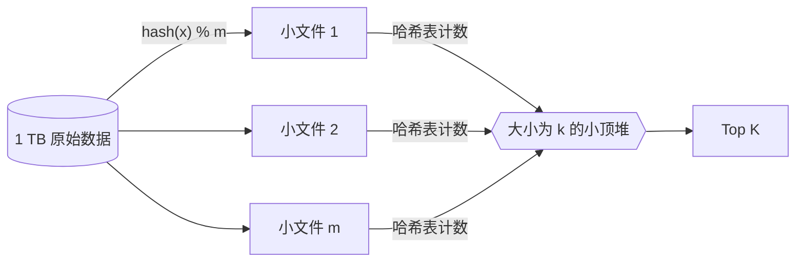

# 流式 / 海量数据 Top K（日志中出现最多的 IP）

> 非力扣原题，面试手写题 · 近两年面经里出现在：**字节 ×2 · 华为**
>
> A 层：所有常见解法都要会，闭卷写出，能讲清追问

## 识别信号

「10 亿个搜索词 / 1 TB 日志，找出现次数最多的 100 个」「数据是一个流，随时要查热门」。数据大到**内存放不下**，或者**只能看一遍**。字节考了 2 次，华为考过一次。这是场景设计题，先讲清思路，再写核心代码。

## 解法一：哈希分桶到小文件 + 每桶计数 + 堆合并

**思路**（精确结果，可以多遍扫描时用）：

1. **分而治之**：遍历一遍数据，按 `hash(x) % m` 把每条数据写到 m 个小文件里。**同一个元素一定落在同一个文件**，所以每个文件里的计数就是这个元素的全局计数。m 取到每个小文件都能放进内存为止。
2. **每个文件单独计数**：读入内存，用哈希表统计次数。
3. **合并**：用一个大小为 k 的**小顶堆**，遍历所有文件的计数结果，保留次数最大的 k 个。



下面用列表模拟小文件：

```python
from collections import Counter
import heapq

def top_k(stream, k, shards=8):
    files = [[] for _ in range(shards)]    # 模拟写到磁盘上的小文件
    for x in stream:
        files[hash(x) % shards].append(x)  # 同一个元素一定落在同一个文件
    heap = []                              # 全局小顶堆，大小 k
    for f in files:
        for x, c in Counter(f).items():    # 每个小文件能放进内存，单独计数
            if len(heap) < k:
                heapq.heappush(heap, (c, x))
            elif c > heap[0][0]:
                heapq.heapreplace(heap, (c, x))
    return sorted(heap, reverse=True)
```

**复杂度**：时间 O(N + U log k)，N 是数据条数，U 是不同元素的个数；读写磁盘各一遍。

**数据倾斜**：如果某个元素特别多，它所在的文件可能还是放不下。可以对这个文件换一个哈希函数再分一次；或者先采样找出超热的元素，单独计数。

## 解法二：流式数据：Count-Min Sketch 近似计数 + 小顶堆

**思路**（只能看一遍、内存固定，允许近似）：

- **Count-Min Sketch**：一个 d 行 w 列的计数表，每行一个哈希函数。加入 x 时，每行 `table[行][hash_i(x) % w]` 加 1；估计 x 的次数时取 d 个格子的**最小值**。因为哈希冲突只会让计数变多，所以估计值**只会多估、不会少估**，取最小值误差最小。
- 再用大小为 k 的小顶堆维护当前估计次数最大的 k 个元素。

```python
import random

class CountMinSketch:
    def __init__(self, width=2000, depth=5, seed=0):
        self.w, self.d = width, depth
        self.table = [[0] * width for _ in range(depth)]
        rnd = random.Random(seed)
        self.salts = [rnd.getrandbits(32) for _ in range(depth)]   # 每行一个哈希函数

    def _cols(self, x):
        return [hash((s, x)) % self.w for s in self.salts]

    def add(self, x, c=1):
        for row, col in enumerate(self._cols(x)):
            self.table[row][col] += c

    def estimate(self, x):                 # 只会多估不会少估，取各行最小值
        return min(self.table[row][col] for row, col in enumerate(self._cols(x)))
```

```python
import heapq

def top_k_stream(stream, k):
    cms = CountMinSketch()
    heap, in_heap = [], {}                 # 小顶堆 (估计次数, 元素)，in_heap 记录堆里的元素
    for x in stream:
        cms.add(x)
        est = cms.estimate(x)
        if x in in_heap:
            in_heap[x] = est               # 已经在堆里：更新次数，重新建堆
            heap = [(c, y) for y, c in in_heap.items()]
            heapq.heapify(heap)
        elif len(heap) < k:
            in_heap[x] = est
            heapq.heappush(heap, (est, x))
        elif est > heap[0][0]:
            _, out = heapq.heapreplace(heap, (est, x))
            del in_heap[out]
            in_heap[x] = est
    return sorted(heap, reverse=True)
```

**复杂度**：每条数据 O(d)（这里为了代码简单，元素已在堆里时重建了一次堆，是 O(k)；生产上用带下标的堆做 O(log k) 更新）。内存 O(w · d + k)，和数据量无关。

误差：设总数为 N，w = ⌈e / ε⌉、d = ⌈ln(1/δ)⌉ 时，估计值超过真实值 εN 的概率不超过 δ。

## 解法三：内存放得下时：哈希表计数 + 小顶堆

不同元素的个数 U 不大时，直接一个哈希表计数，最后用小顶堆选 k 个，O(N + U log k)。要支持**随时查询**，就在每次计数变化时更新堆，页面末尾的 Java 版就是这个写法。

## 方案怎么选

| 场景 | 方案 | 结果 |
|---|---|---|
| 不同元素能放进内存 | 哈希表 + 小顶堆 | 精确 |
| 放不下，可以多遍扫描（离线日志） | 哈希分桶 + 每桶计数 + 堆合并；也可以用 MapReduce / Spark 做同样的事 | 精确 |
| 流式、只能看一遍、内存固定 | Count-Min Sketch + 小顶堆；或 Space-Saving 算法 | 近似 |
| 多台机器 | 按 hash 分片到各机器，各自算 Top K，再汇总 | 分片按 hash 时精确 |

## 易错点

- 随机分到小文件（而不是按 hash）：同一个元素散在多个文件里，每个文件里的 Top K 合起来不是全局 Top K。
- 用大顶堆把所有元素放进去：内存 O(U)，不符合题意。
- 多机汇总时每台只交前 k 名：如果分片不是按元素 hash，结果可能错（某个元素在每台都排第 k + 1，总和却是第一）。

## 面试追问

- **热搜按时间窗口（最近 1 小时）？** 按分钟分桶计数，滑动窗口加上新桶、减去过期桶；或者用 Redis 的 ZSET 每分钟一个 key，查询时 `ZUNIONSTORE` 合并。见八股 [Redis 数据结构](https://bingqin2.github.io/bagu-notes/07-redis/data-structures)。
- **布隆过滤器和 Count-Min Sketch 的区别？** 布隆过滤器判断「在不在」（只会误报存在），每格一个比特；Count-Min Sketch 估计「有几个」（只会多估），每格一个计数器。结构很像。
- **还有哪些海量数据题是同一个套路？** 两个大文件求共同的 URL（都按同一个 hash 分桶，对应桶求交集）；找中位数（按数值范围分桶，统计每桶个数，确定中位数所在的桶）。

## Java 版（流式，精确计数 + 小顶堆）

```java
class StreamTopK {
    private final int k;
    private final Map<String, Integer> count = new HashMap<>();
    // 小顶堆存当前前 k 名；次数变化时先删再加，保证堆里的次数是最新的
    private final PriorityQueue<String> heap;

    StreamTopK(int k) {
        this.k = k;
        heap = new PriorityQueue<>((a, b) -> count.get(a) - count.get(b));
    }

    public void add(String x) {
        boolean inHeap = heap.remove(x);       // O(k)
        count.merge(x, 1, Integer::sum);
        if (inHeap || heap.size() < k) heap.offer(x);
        else if (count.get(x) > count.get(heap.peek())) {
            heap.poll();
            heap.offer(x);
        }
    }

    public List<String> top() {
        List<String> res = new ArrayList<>(heap);
        res.sort((a, b) -> count.get(b) - count.get(a));
        return res;
    }
}
```

## 相关题

- [347. 前 K 个高频元素](./lc347)
- [692. 前K个高频单词](./lc692)
- [295. 数据流的中位数](./lc295)
