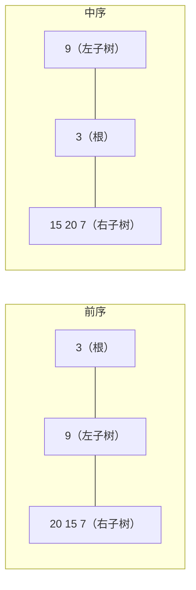

# 105. 从前序与中序遍历序列构造二叉树

> [力扣 105](https://leetcode.cn/problems/construct-binary-tree-from-preorder-and-inorder-traversal/) · 近两年面经里出现在：**小红书**
>
> A 层：所有常见解法都要会，闭卷写出，能讲清追问

## 识别信号

给两种遍历序列还原二叉树。规律：**前序的第一个是根**；在中序里找到根，左边是左子树、右边是右子树；左子树的大小决定了前序里怎么切分。小红书压力面考过，还追问了「建出来的树是否唯一」。



## 解法一：递归 + 哈希表定位根

**思路**：用哈希表存「值 → 中序下标」，O(1) 找到根的位置 k。左子树大小 = k − 中序起点。然后递归构造左右子树。用下标区间代替切片，避免复制数组。

```python
def buildTree(preorder, inorder):
    idx = {v: i for i, v in enumerate(inorder)}
    def build(pl, pr, il):                 # 前序区间 [pl, pr)，对应中序从 il 开始
        if pl == pr: return None
        root_val = preorder[pl]
        k = idx[root_val]                  # 根在中序里的位置
        left_size = k - il
        root = TreeNode(root_val)
        root.left = build(pl + 1, pl + 1 + left_size, il)
        root.right = build(pl + 1 + left_size, pr, k + 1)
        return root
    return build(0, len(preorder), 0)
```

**复杂度**：时间 O(n)，空间 O(n)（哈希表 + 递归栈）。如果每次都在中序里线性查找根，时间会退化成 O(n²)。

## 解法二：迭代（栈）

**思路**：按前序依次创建结点。栈里是「还没确定右孩子」的结点。新结点默认是栈顶的左孩子；如果栈顶等于中序当前值，说明栈顶的左子树已经构造完，不断出栈，最后一个出栈的结点就是新结点的父亲，新结点是它的右孩子。

```python
def buildTree(preorder, inorder):
    if not preorder: return None
    root = TreeNode(preorder[0]); stack = [root]; j = 0
    for v in preorder[1:]:
        node = TreeNode(v)
        parent = None
        while stack and stack[-1].val == inorder[j]:   # 栈顶等于中序当前值：左子树走完了
            parent = stack.pop(); j += 1
        if parent: parent.right = node
        else: stack[-1].left = node
        stack.append(node)
    return root
```

**复杂度**：时间 O(n)，空间 O(n)。思路比较绕，面试写解法一就够了，知道有迭代写法即可。

## 易错点

- 题目保证没有重复值，这样才能用哈希表定位根。
- 左右子树的前序区间算错：左子树是 `[pl+1, pl+1+leftSize)`，右子树从 `pl+1+leftSize` 开始。
- 用切片写法（`preorder[1:k+1]`）简洁但每层都在复制数组，时间变成 O(n²)。

## 面试追问

- **中序 + 后序能还原吗？** 能，[106](./lc106)：后序的**最后一个**是根，其余一样。
- **前序 + 后序能唯一还原吗？** 不能。当一个结点只有一个孩子时，分不清是左孩子还是右孩子。只有在每个结点要么有两个孩子、要么没有孩子（满二叉树）时才唯一（[889](https://leetcode.cn/problems/construct-binary-tree-from-preorder-and-postorder-traversal/)）。
- **有重复值怎么办？** 无法唯一确定。比如前序和中序都是 [1, 1]，可以是根带左孩子，也可以是根带右孩子。
- **怎么把树序列化存起来？** 前序 + 空结点标记就能唯一还原，见 [297](./lc297)。

## Java 版

```java
private Map<Integer, Integer> idx = new HashMap<>();
private int[] pre;

public TreeNode buildTree(int[] preorder, int[] inorder) {
    pre = preorder;
    for (int i = 0; i < inorder.length; i++) idx.put(inorder[i], i);
    return build(0, preorder.length, 0);
}

// 前序区间 [pl, pr)，对应的中序区间从 il 开始
private TreeNode build(int pl, int pr, int il) {
    if (pl == pr) return null;
    TreeNode root = new TreeNode(pre[pl]);
    int k = idx.get(pre[pl]);
    int leftSize = k - il;
    root.left = build(pl + 1, pl + 1 + leftSize, il);
    root.right = build(pl + 1 + leftSize, pr, k + 1);
    return root;
}
```

## 相关题

- [106. 从中序与后序遍历序列构造二叉树](./lc106)
- [297. 二叉树的序列化与反序列化](./lc297)
