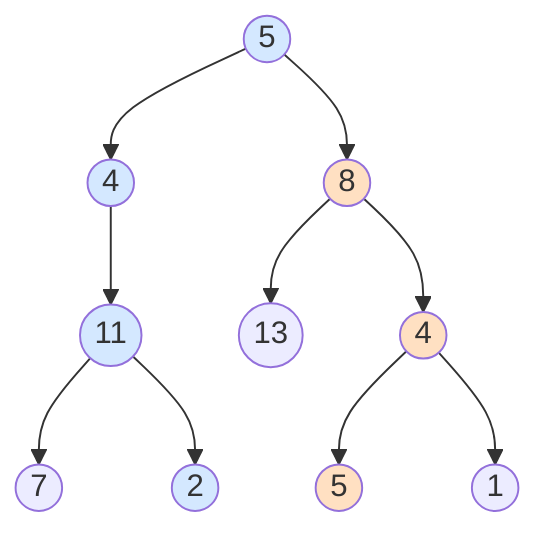

# 113. 路径总和 II

> [力扣 113](https://leetcode.cn/problems/path-sum-ii/) · 中等 · 来源：面经 · 近两年面经：**字节**
>
> A 层：所有常见解法都要会，闭卷写出，能讲清追问

## 识别信号

[112](./lc112) 的升级：输出所有根到叶、和为目标值的路径。需要记录路径，就是**回溯**：进入结点时加入路径，离开时移除。

## 解法一：DFS + 回溯

**思路**：用一个 path 列表记录当前路径。到叶子时如果剩余值是 0，就把 path 的**副本**加入结果。递归返回前把当前结点从 path 里弹出。

```python
def pathSum(root, target):
    res, path = [], []
    def dfs(node, remain):
        if not node: return
        path.append(node.val)
        remain -= node.val
        if not node.left and not node.right and remain == 0:
            res.append(path[:])            # 必须复制，path 之后还会变
        dfs(node.left, remain)
        dfs(node.right, remain)
        path.pop()                         # 回溯
    dfs(root, target)
    return res
```

**复杂度**：时间 O(n²)：最坏情况下每个叶子都要复制一条长度 O(n) 的路径；空间 O(h)（不算结果）。



target = 22 时有两条路径：5 → 4 → 11 → 2 和 5 → 8 → 4 → 5。

## 解法二：BFS + 记录父结点

**思路**：BFS 时用哈希表记下每个结点的父结点，和路径和一起入队。到叶子时如果和等于目标值，就顺着父指针往回拼出路径，再反转。空间换来了不用回溯，但代码更长，了解即可。

## 易错点

- 加入结果时没复制：`res.append(path)` 加入的是同一个列表的引用，之后回溯会把它清空。Python 用 `path[:]`，Java 用 `new ArrayList<>(path)`。
- 在叶子处找到答案后直接 return，没有执行 `path.pop()`：路径没有恢复，后面的结果全错。上面的写法把 pop 放在最后，所有分支都会执行到。

## 面试追问

- **回溯的模板是什么？** 做选择 → 递归 → 撤销选择。这道题的「选择」就是把当前结点加入路径。和[全排列](/10-backtracking/lc46)、[组合总和](/10-backtracking/lc39)是同一个框架。
- **只要路径条数，不要具体路径？** 不需要 path，直接计数。路径可以从任意结点开始时用 [437](./lc437) 的前缀和方法。

## Java 版

```java
public List<List<Integer>> pathSum(TreeNode root, int targetSum) {
    List<List<Integer>> res = new ArrayList<>();
    dfs(root, targetSum, new ArrayList<>(), res);
    return res;
}

private void dfs(TreeNode node, int remain, List<Integer> path, List<List<Integer>> res) {
    if (node == null) return;
    path.add(node.val);
    remain -= node.val;
    if (node.left == null && node.right == null && remain == 0) res.add(new ArrayList<>(path));
    dfs(node.left, remain, path, res);
    dfs(node.right, remain, path, res);
    path.remove(path.size() - 1);                // 回溯
}
```

## 相关题

- [112. 路径总和](./lc112)
- [437. 路径总和 III](./lc437)
- [257. 二叉树的所有路径](./lc257)
