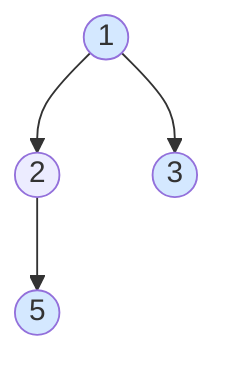

# 199. 二叉树的右视图

> [力扣 199](https://leetcode.cn/problems/binary-tree-right-side-view/) · 中等 · 来源：Hot 100 · 面经 · 近两年面经：**字节**
>
> A 层：所有常见解法都要会，闭卷写出，能讲清追问

## 识别信号

从右边看二叉树能看到的结点，也就是**每一层最右边的那个**。注意不是「一直往右走」：右子树比左子树矮时，下面几层能看到的是左子树里的结点。

## 解法一：BFS，取每层最后一个

**思路**：在 [102 层序遍历](./lc102) 的基础上，只保留每层最后一个结点。

```python
from collections import deque

def levelOrder(root):
    if not root: return []
    res, q = [], deque([root])
    while q:
        level = []
        for _ in range(len(q)):            # 当前队列里正好是一层
            node = q.popleft()
            level.append(node.val)
            if node.left: q.append(node.left)
            if node.right: q.append(node.right)
        res.append(level)
    return res
```

```python
def rightSideView(root):
    return [level[-1] for level in levelOrder(root)]
```

**复杂度**：时间 O(n)，空间 O(w)。

## 解法二：DFS，先右后左

**思路**：先访问右孩子再访问左孩子，那么每一层**第一次到达**的结点就是最右边的。用「深度 == 结果长度」判断是不是第一次到达这一层。

```python
def rightSideView(root):
    res = []
    def dfs(node, depth):
        if not node: return
        if depth == len(res): res.append(node.val)   # 每层第一次到达的就是最右边的
        dfs(node.right, depth + 1)                   # 先右后左
        dfs(node.left, depth + 1)
    dfs(root, 0)
    return res
```

**复杂度**：时间 O(n)，空间 O(h)。



上图的右视图是 [1, 3, 5]：第 3 层只有左子树里的 5。

## 易错点

- 只沿右孩子一直往下走：会漏掉上图里的 5。
- DFS 版本先左后右：每层第一个到达的就变成了最左边的结点（那是左视图）。

## 面试追问

- **左视图？** BFS 取每层第一个；DFS 先左后右。
- **从上往下看（俯视图）？** 给每个结点一个水平坐标（左孩子 −1，右孩子 +1），BFS 时每个坐标第一次出现的结点就是能看到的。

## Java 版

```java
public List<Integer> rightSideView(TreeNode root) {
    List<Integer> res = new ArrayList<>();
    dfs(root, 0, res);
    return res;
}

private void dfs(TreeNode node, int depth, List<Integer> res) {
    if (node == null) return;
    if (depth == res.size()) res.add(node.val);   // 每层第一次到达的结点
    dfs(node.right, depth + 1, res);           // 先右后左
    dfs(node.left, depth + 1, res);
}
```

## 相关题

- [102. 二叉树的层序遍历](./lc102)
- [116 / 117. 填充每个节点的下一个右侧节点指针](./lc117)
