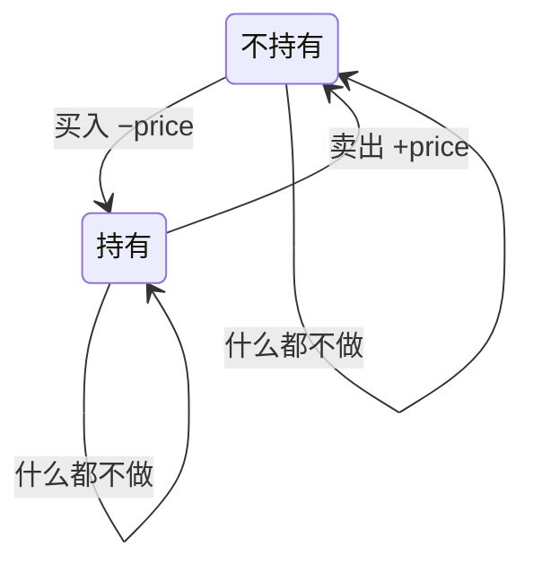

# 121. 买卖股票的最佳时机

> [力扣 121](https://leetcode.cn/problems/best-time-to-buy-and-sell-stock/) · 近两年面经里出现在：**字节 · 快手**
>
> A 层：所有常见解法都要会，闭卷写出，能讲清追问

## 识别信号

只能买卖**一次**，求最大利润。股票系列一共六道（121、122、123、188、309、714），这道是起点。面试官常常从这题出发，一路追问到「能交易多次」「有冷冻期」「有手续费」。

## 解法一：维护历史最低价（一次遍历）

**思路**：如果在第 i 天卖，最好的买入日就是 i 之前价格最低的那天。所以边走边记录最低价，用今天的价格减去它。

```python
def maxProfit(prices):
    low, best = float("inf"), 0
    for p in prices:
        low = min(low, p)
        best = max(best, p - low)
    return best
```

**复杂度**：时间 O(n)，空间 O(1)。

## 解法二：状态机 DP（通用框架）

**思路**：每天结束时只有两种状态：**持有**股票、**不持有**股票。

- 持有：昨天就持有；或者今天买入（只能买一次，所以是 −price）。
- 不持有：昨天就不持有；或者今天卖出（昨天持有 + price）。

```python
def maxProfit(prices):
    hold, free = -prices[0], 0     # 持有股票 / 不持有股票时的最大收益
    for p in prices[1:]:
        hold = max(hold, -p)       # 只能买一次，所以是 -p 而不是 free - p
        free = max(free, hold + p)
    return free
```

**复杂度**：时间 O(n)，空间 O(1)。



这个框架能解决整个股票系列，只需要改转移方程：

| 题目 | 变化 | 改动 |
|---|---|---|
| 121 只能交易一次 | | 买入时是 `-p` |
| [122](./lc122) 不限次数 | | 买入时是 `free - p` |
| [309](./lc309) 有冷冻期 | 卖出后隔一天才能买 | 买入用前天的 `free` |
| [714](./lc714) 有手续费 | | 卖出时减去手续费 |
| [123](./lc123) / [188](./lc188) 最多 k 次 | | 状态加一维：已经交易了几次 |

## 易错点

- 用双重循环枚举买卖日：O(n²)，会超时。
- 价格一直下跌时答案是 0，不能返回负数。
- 状态机写法里，121 的买入必须是 `-p` 而不是 `free - p`，否则就变成了可以交易多次（122）。

## 面试追问

- **要返回哪天买、哪天卖？** 记录最低价出现的下标，更新最大利润时同时记下买卖日。
- **122 不限次数有没有更简单的写法？** 有：所有上涨的差价都吃掉，`sum(max(0, p[i] - p[i-1]))`，这是贪心。
- **这道题和最大子数组和有什么关系？** 把价格转成每天的涨跌 `p[i] - p[i-1]`，最大利润就是涨跌数组的最大子数组和（[53](./lc53)）。

## Java 版

```java
public int maxProfit(int[] prices) {
    int low = Integer.MAX_VALUE, best = 0;
    for (int p : prices) {
        low = Math.min(low, p);
        best = Math.max(best, p - low);
    }
    return best;
}
```

## 相关题

- [122. 买卖股票的最佳时机 II](./lc122)
- [309. 含冷冻期](./lc309)
- [714. 含手续费](./lc714)
- [123. 最多两次](./lc123)、[188. 最多 k 次](./lc188)
