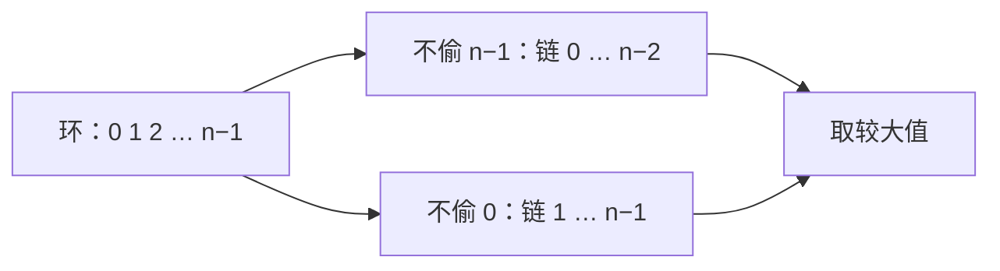

# 213. 打家劫舍 II

> [力扣 213](https://leetcode.cn/problems/house-robber-ii/) · 中等 · 来源：面经 · 近两年面经：**字节（打家劫舍变体）**
>
> A 层：所有常见解法都要会，闭卷写出，能讲清追问

## 识别信号

[198 打家劫舍](./lc198) 的环形版：第一间和最后一间相邻。环形问题的通用拆法是**分类讨论把环拆成链**。

## 解法：拆成两条链

**思路**：首尾不能同时偷，所以至少有一间不偷：

- 情况一：不偷最后一间 → 在 `nums[0 .. n−2]` 上做 198。
- 情况二：不偷第一间 → 在 `nums[1 .. n−1]` 上做 198。

两种情况取较大值。只有一间房时直接返回它。



```python
def rob(nums):
    def line(a):                     # 198 的滚动变量写法
        prev2 = prev1 = 0
        for x in a:
            prev2, prev1 = prev1, max(prev1, prev2 + x)
        return prev1
    if len(nums) == 1:
        return nums[0]
    return max(line(nums[:-1]), line(nums[1:]))
```

**复杂度**：时间 O(n)，空间 O(1)（切片会复制数组，Java 版用下标区间，没有复制）。

## 易错点

- 忘了 n = 1：两个切片都是空的，答案会变成 0。
- 拆成「偷第一间」和「不偷第一间」也行，但要处理得更细。两条链的写法最不容易错。

## 面试追问

- **为什么两种情况就覆盖了所有方案？** 最优方案里第一间和最后一间至少有一间没偷，所以它一定落在两种情况之一里。
- **其他环形问题也能这样拆吗？** 可以。比如 [918 环形子数组的最大和](./lc918)：答案要么是普通的最大子数组和，要么是总和减去最小子数组和。

## Java 版

```java
public int rob(int[] nums) {
    int n = nums.length;
    if (n == 1) return nums[0];
    return Math.max(robRange(nums, 0, n - 2), robRange(nums, 1, n - 1));
}

private int robRange(int[] nums, int lo, int hi) {
    int prev2 = 0, prev1 = 0;
    for (int i = lo; i <= hi; i++) {
        int cur = Math.max(prev1, prev2 + nums[i]);
        prev2 = prev1;
        prev1 = cur;
    }
    return prev1;
}
```

## 相关题

- [198. 打家劫舍](./lc198)
- [337. 打家劫舍 III](./lc337)
- [918. 环形子数组的最大和](./lc918)
