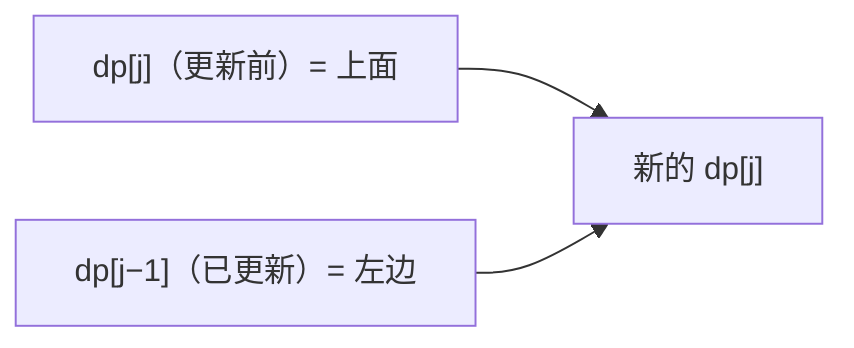

# 62. 不同路径

> [力扣 62](https://leetcode.cn/problems/unique-paths/) · 近两年面经里出现在：**字节**
>
> A 层：所有常见解法都要会，闭卷写出，能讲清追问

## 识别信号

网格里只能向右或向下走，求路径数。二维 DP 的入门题，重点在**滚动数组压缩空间**和**组合数学解法**。

## 解法一：二维 DP

**思路**：dp[i][j] = 走到 (i, j) 的路径数 = 从上面来的 dp[i−1][j] + 从左边来的 dp[i][j−1]。第一行和第一列都只有一条路，初始化为 1。

```python
def uniquePaths(m, n):
    dp = [[1] * n for _ in range(m)]
    for i in range(1, m):
        for j in range(1, n):
            dp[i][j] = dp[i - 1][j] + dp[i][j - 1]
    return dp[-1][-1]
```

**复杂度**：时间 O(mn)，空间 O(mn)。

## 解法二：滚动数组

**思路**：算第 i 行时只用到第 i−1 行。用一维数组，dp[j] 在更新前存的是「上一行的值」，dp[j−1] 已经是「这一行的值」：`dp[j] += dp[j-1]`。



```python
def uniquePaths(m, n):
    dp = [1] * n
    for _ in range(1, m):
        for j in range(1, n):
            dp[j] += dp[j - 1]     # 新的 dp[j] = 上面的 dp[j] + 左边的 dp[j-1]
    return dp[-1]
```

**复杂度**：时间 O(mn)，空间 O(n)。

## 解法三：组合数学

**思路**：从左上到右下一共要走 m−1 次向下、n−1 次向右，总共 m+n−2 步。路径数就是在这些步里选哪 m−1 步向下：C(m+n−2, m−1)。

```python
import math

def uniquePaths(m, n):
    return math.comb(m + n - 2, m - 1)
```

**复杂度**：时间 O(min(m, n))。Java 里手算组合数时要边乘边除，用 long，防止溢出。

## 易错点

- 二维 DP 忘了初始化第一行和第一列。
- 一维数组从右往左遍历：那样 dp[j−1] 还是上一行的值，结果错误。这里必须从左往右。

## 面试追问

- **有障碍物？** [63 不同路径 II](./lc63)：障碍格的 dp 设为 0，第一行或第一列遇到障碍后，后面的都是 0。组合数学解法就不能用了。
- **求最小路径和？** [64](./lc64)：把加法换成 `min(上, 左) + grid[i][j]`。
- **可以往四个方向走？** 那就不能用 DP 了（有环），要用 DFS 或 BFS。

## Java 版

```java
public int uniquePaths(int m, int n) {
    int[] dp = new int[n];
    Arrays.fill(dp, 1);
    for (int i = 1; i < m; i++)
        for (int j = 1; j < n; j++)
            dp[j] += dp[j - 1];
    return dp[n - 1];
}
```

## 相关题

- [63. 不同路径 II](./lc63)
- [64. 最小路径和](./lc64)
- [120. 三角形最小路径和](./lc120)
