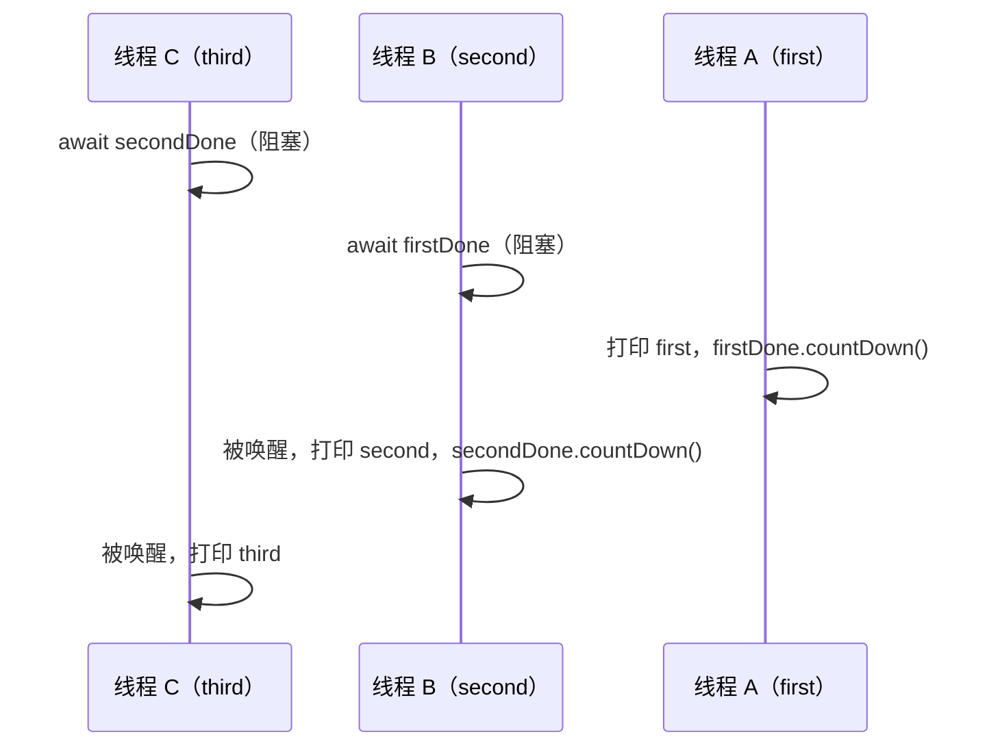

# 1114. 按序打印

> [力扣 1114](https://leetcode.cn/problems/print-in-order/) · 简单 · 近两年面经：**阿里**（多线程有序打印）、**腾讯**（线程协作）
>
> A 层：所有常见解法都要会，闭卷写出，能讲清追问

## 识别信号

三个线程分别调用 `first()`、`second()`、`third()`，启动顺序不确定，要保证打印顺序是 first → second → third。本质是**线程之间的先后依赖**：B 必须等 A 完成。

这道题的价值在于用它把 Java 各种同步工具过一遍。

## 解法一：CountDownLatch（最直观）

```java
class Foo {
    private final CountDownLatch firstDone = new CountDownLatch(1);
    private final CountDownLatch secondDone = new CountDownLatch(1);

    public void first(Runnable printFirst) throws InterruptedException {
        printFirst.run();
        firstDone.countDown();
    }

    public void second(Runnable printSecond) throws InterruptedException {
        firstDone.await();
        printSecond.run();
        secondDone.countDown();
    }

    public void third(Runnable printThird) throws InterruptedException {
        secondDone.await();
        printThird.run();
    }
}
```

## 解法二：Semaphore

把两个 `CountDownLatch` 换成两个初始值为 0 的 `Semaphore`：`first` 做完 `s1.release()`，`second` 先 `s1.acquire()`，做完 `s2.release()`，`third` 先 `s2.acquire()`。

## 解法三：synchronized + wait / notifyAll

```java
class Foo {
    private int stage = 1;

    public synchronized void first(Runnable printFirst) {
        printFirst.run();
        stage = 2;
        notifyAll();
    }

    public synchronized void second(Runnable printSecond) throws InterruptedException {
        while (stage != 2) wait();
        printSecond.run();
        stage = 3;
        notifyAll();
    }

    public synchronized void third(Runnable printThird) throws InterruptedException {
        while (stage != 3) wait();
        printThird.run();
    }
}
```

## 解法四：Python（Event）

```python
import threading

class Foo:
    def __init__(self):
        self.first_done = threading.Event()
        self.second_done = threading.Event()

    def first(self, printFirst):
        printFirst()
        self.first_done.set()

    def second(self, printSecond):
        self.first_done.wait()
        printSecond()
        self.second_done.set()

    def third(self, printThird):
        self.second_done.wait()
        printThird()
```

Java 解法一和 Python 解法都测试过：以 third、second、first 的顺序启动线程，重复 20–30 次，输出都是 1、2、3。

## 图解



## 易错点

- 用一个 `volatile int` 加空循环（`while (stage != 2) {}`）：结果正确，但白白占用 CPU。力扣能过，面试会被追问。
- wait 用 `if` 而不是 `while` 判断条件。
- 只用 `notify()`：可能唤醒了 third 而不是 second，third 发现不满足又睡回去，second 永远没被唤醒。

## 面试追问

- **这些工具的区别？** `CountDownLatch` 一次性，计数到 0 就不能再用；`Semaphore` 可以反复 acquire / release；`wait/notify` 要配合 synchronized 和一个状态变量；`CompletableFuture` 也能表达依赖：`f1.thenRun(second).thenRun(third)`。
- **N 个线程按顺序执行？** 准备 N − 1 个 latch（或信号量），第 i 个线程等第 i − 1 个，完成后通知第 i + 1 个。
- **要循环打印 ABCABC…？** 那就是 [1115](./lc1115) 的思路：信号量形成一个环。

## 相关题

- [1115. 交替打印 FooBar](./lc1115)
- [1116. 打印零与奇偶数](./lc1116)
- [生产者消费者](./producer-consumer)
