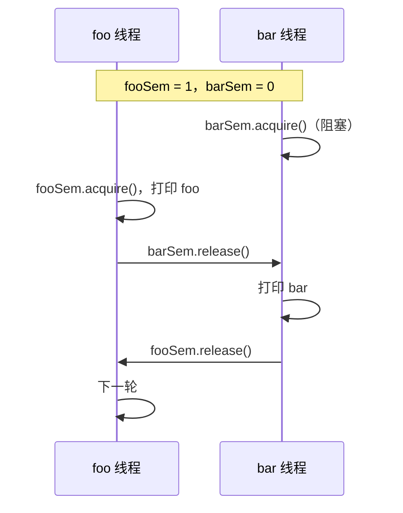

# 1115. 交替打印 FooBar

> [力扣 1115](https://leetcode.cn/problems/print-foobar-alternately/) · 中等 · 近两年面经：**腾讯 ×2**（后端合集、后端日常实习里都手撕了「交替打印奇偶数」）
>
> A 层：所有常见解法都要会，闭卷写出，能讲清追问

## 识别信号

两个线程**轮流**执行，循环 n 次。面试里最常见的变体是「两个线程交替打印 1 到 100 的奇数和偶数」，解法完全一样。

## 解法一：两个信号量（推荐）

**思路**：`fooSem` 初始为 1（foo 先走），`barSem` 初始为 0。foo 打印完给 bar 一个许可，bar 打印完再还给 foo，形成一个「接力棒」。

```java
class FooBar {
    private final int n;
    private final Semaphore fooSem = new Semaphore(1);
    private final Semaphore barSem = new Semaphore(0);

    public FooBar(int n) { this.n = n; }

    public void foo(Runnable printFoo) throws InterruptedException {
        for (int i = 0; i < n; i++) {
            fooSem.acquire();
            printFoo.run();
            barSem.release();
        }
    }

    public void bar(Runnable printBar) throws InterruptedException {
        for (int i = 0; i < n; i++) {
            barSem.acquire();
            printBar.run();
            fooSem.release();
        }
    }
}
```

## 解法二：ReentrantLock + Condition

```java
class FooBar {
    private final int n;
    private final ReentrantLock lock = new ReentrantLock();
    private final Condition turnChanged = lock.newCondition();
    private boolean fooTurn = true;

    public FooBar(int n) { this.n = n; }

    public void foo(Runnable printFoo) throws InterruptedException {
        for (int i = 0; i < n; i++) {
            lock.lock();
            try {
                while (!fooTurn) turnChanged.await();
                printFoo.run();
                fooTurn = false;
                turnChanged.signal();
            } finally {
                lock.unlock();
            }
        }
    }

    public void bar(Runnable printBar) throws InterruptedException {
        for (int i = 0; i < n; i++) {
            lock.lock();
            try {
                while (fooTurn) turnChanged.await();
                printBar.run();
                fooTurn = true;
                turnChanged.signal();
            } finally {
                lock.unlock();
            }
        }
    }
}
```

synchronized + `wait/notifyAll` 的写法结构一样：把 `lock/unlock` 换成 synchronized，`await/signal` 换成 `wait/notifyAll`。

## 解法三：Python（信号量）

```python
import threading

class FooBar:
    def __init__(self, n):
        self.n = n
        self.foo_sem = threading.Semaphore(1)
        self.bar_sem = threading.Semaphore(0)

    def foo(self, printFoo):
        for _ in range(self.n):
            self.foo_sem.acquire()
            printFoo()
            self.bar_sem.release()

    def bar(self, printBar):
        for _ in range(self.n):
            self.bar_sem.acquire()
            printBar()
            self.foo_sem.release()
```

信号量版本的 Java 和 Python 都测试过：先启动 bar 线程，输出仍然严格是 foobar 交替。

## 变体：两个线程交替打印 1–100

```java
class OddEven {
    private final Semaphore odd = new Semaphore(1), even = new Semaphore(0);

    void printOdd() throws InterruptedException {
        for (int i = 1; i <= 100; i += 2) {
            odd.acquire();
            System.out.println(i);
            even.release();
        }
    }

    void printEven() throws InterruptedException {
        for (int i = 2; i <= 100; i += 2) {
            even.acquire();
            System.out.println(i);
            odd.release();
        }
    }
}
```

## 图解



## 易错点

- 两个信号量的初始值写反，或者都写成 1：两个线程可能同时打印。
- Condition 版本用 `if` 判断轮次：虚假唤醒后会打印错。
- 每轮循环都在锁外打印：打印必须在拿到「轮次」之后、交出轮次之前。

## 面试追问

- **三个线程循环打印 ABC？** 三个信号量形成环：A 初始 1，B、C 初始 0；A 打印后释放 B，B 释放 C，C 释放 A。Condition 版本就用一个变量记录轮到谁（0、1、2），每个线程等到自己的编号。
- **用一个 volatile 变量 + `Thread.yield()` 自旋行不行？** 能过，但浪费 CPU，面试官通常会要求改成阻塞等待。
- **信号量和 Condition 版本哪个更好？** 信号量最短，不需要状态变量；Condition 更通用，条件复杂时更容易扩展。

## 相关题

- [1114. 按序打印](./lc1114)
- [1116. 打印零与奇偶数](./lc1116)
