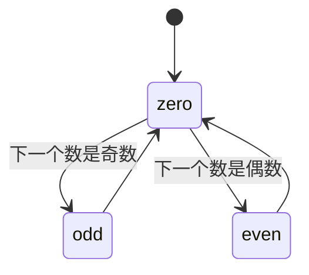

# 1116. 打印零与奇偶数

> [力扣 1116](https://leetcode.cn/problems/print-zero-even-odd/) · 中等 · 近两年面经：**腾讯**（交替打印奇偶数的变体）
>
> A 层：所有常见解法都要会，闭卷写出，能讲清追问

## 识别信号

三个线程：`zero` 打印 0，`even` 打印偶数，`odd` 打印奇数，输出 `0102030405…`。比 [1115](./lc1115) 多了一点：**zero 打印完要根据下一个数的奇偶决定唤醒谁**。

## 解法一：三个信号量

**思路**：`zero` 初始为 1，`odd`、`even` 初始为 0。zero 每次打印 0 后，看下一个数 i 的奇偶，释放对应的信号量；odd / even 打印完再把许可还给 zero。

```java
class ZeroEvenOdd {
    private final int n;
    private final Semaphore zero = new Semaphore(1);
    private final Semaphore even = new Semaphore(0);
    private final Semaphore odd = new Semaphore(0);

    public ZeroEvenOdd(int n) { this.n = n; }

    public void zero(IntConsumer printNumber) throws InterruptedException {
        for (int i = 1; i <= n; i++) {
            zero.acquire();
            printNumber.accept(0);
            if (i % 2 == 1) odd.release();
            else even.release();
        }
    }

    public void even(IntConsumer printNumber) throws InterruptedException {
        for (int i = 2; i <= n; i += 2) {
            even.acquire();
            printNumber.accept(i);
            zero.release();
        }
    }

    public void odd(IntConsumer printNumber) throws InterruptedException {
        for (int i = 1; i <= n; i += 2) {
            odd.acquire();
            printNumber.accept(i);
            zero.release();
        }
    }
}
```

## 解法二：ReentrantLock + Condition（状态机）

**思路**：用一个变量 `state` 表示轮到谁：0 = zero，1 = odd，2 = even。每个线程等到 `state` 等于自己再打印，打印完设置下一个状态，`signalAll()`。

```java
class ZeroEvenOdd {
    private final int n;
    private final ReentrantLock lock = new ReentrantLock();
    private final Condition cond = lock.newCondition();
    private int state = 0;      // 0：zero，1：odd，2：even
    private int next = 1;       // 下一个要打印的数

    public ZeroEvenOdd(int n) { this.n = n; }

    public void zero(IntConsumer printNumber) throws InterruptedException {
        for (int i = 0; i < n; i++) {
            lock.lock();
            try {
                while (state != 0) cond.await();
                printNumber.accept(0);
                state = (next % 2 == 1) ? 1 : 2;
                cond.signalAll();
            } finally {
                lock.unlock();
            }
        }
    }

    public void odd(IntConsumer printNumber) throws InterruptedException {
        for (int i = 1; i <= n; i += 2) await(1, printNumber);
    }

    public void even(IntConsumer printNumber) throws InterruptedException {
        for (int i = 2; i <= n; i += 2) await(2, printNumber);
    }

    private void await(int me, IntConsumer printNumber) throws InterruptedException {
        lock.lock();
        try {
            while (state != me) cond.await();
            printNumber.accept(next++);
            state = 0;
            cond.signalAll();
        } finally {
            lock.unlock();
        }
    }
}
```

这里只有一个 Condition，所以要用 `signalAll`。想精确唤醒，可以给三个线程各建一个 Condition。

## 解法三：Python（信号量）

```python
import threading

class ZeroEvenOdd:
    def __init__(self, n):
        self.n = n
        self.z = threading.Semaphore(1)
        self.e = threading.Semaphore(0)
        self.o = threading.Semaphore(0)

    def zero(self, printNumber):
        for i in range(1, self.n + 1):
            self.z.acquire()
            printNumber(0)
            (self.o if i % 2 else self.e).release()

    def even(self, printNumber):
        for i in range(2, self.n + 1, 2):
            self.e.acquire()
            printNumber(i)
            self.z.release()

    def odd(self, printNumber):
        for i in range(1, self.n + 1, 2):
            self.o.acquire()
            printNumber(i)
            self.z.release()
```

信号量版本的 Java 和 Python 都测试过，n = 1、2、5、10 时输出都正确。

## 图解



## 易错点

- even 和 odd 线程的循环次数：分别是 n / 2 次和 (n + 1) / 2 次。用 `range(2, n+1, 2)` / `range(1, n+1, 2)` 直接表达最不容易错。
- n = 1 时 even 线程一次都不执行，要确认不会卡住。
- 状态机版本里，`next` 只能在持有锁时修改。

## 面试追问

- **这类题的通用套路？** 画出状态图（谁之后轮到谁），每个状态一个信号量，或者一个状态变量 + Condition。
- **哪种方案性能更好？** 信号量精确唤醒，没有无效的唤醒；单个 Condition + `signalAll` 每次会唤醒所有等待者，其中大部分会重新睡回去。线程少时差别不大。
- **能用 `CyclicBarrier` 吗？** 不合适。它是让一组线程**同时**到达某个点，这里要的是线程**依次**执行。

## 相关题

- [1114. 按序打印](./lc1114)
- [1115. 交替打印 FooBar](./lc1115)
