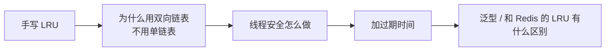
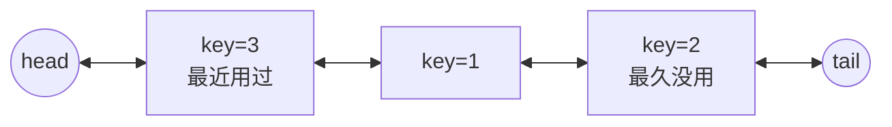

# 146. LRU 缓存

> [力扣 146](https://leetcode.cn/problemset/?search=146) · 近两年面经里出现在：**字节 ×3 · 美团 ×2 · 腾讯 · 阿里 · 小红书 ×2 · 小米**。这份样本里它是后端手撕出现次数最多的一道题。

## 识别信号

要求 `get` 和 `put` 都是 O(1)，容量满了淘汰最久没用的。面试的追问路线基本固定：



## 解法一：哈希表 + 双向链表（必须会手写）

**思路**：

- 哈希表 `key → 结点`，O(1) 找到结点。
- 双向链表按使用时间排序：**头部是最近用过的，尾部是最久没用的**。
- `get`：找到结点，把它移到头部。
- `put`：已存在就更新值并移到头部；不存在就新建结点插到头部，超过容量就删掉尾部结点，并从哈希表里删掉它的 key。
- 用头尾两个哨兵结点，插入和删除时就不用判断空指针。

**为什么必须是双向链表？** 删除一个结点要修改它前一个结点的 `next`。单链表找前驱要 O(n)，双向链表直接用 `node.prev`。

**为什么结点里还要存 key？** 淘汰尾部结点时，要用它的 key 去哈希表里删除对应的项。



```python
class Node:
    __slots__ = ("key", "val", "prev", "next")

    def __init__(self, key=0, val=0):
        self.key, self.val = key, val
        self.prev = self.next = None


class LRUCache:
    def __init__(self, capacity: int):
        self.cap = capacity
        self.map = {}
        self.head, self.tail = Node(), Node()   # 哨兵
        self.head.next, self.tail.prev = self.tail, self.head

    def _remove(self, node):
        node.prev.next = node.next
        node.next.prev = node.prev

    def _add_front(self, node):
        node.prev, node.next = self.head, self.head.next
        self.head.next.prev = node
        self.head.next = node

    def get(self, key: int) -> int:
        node = self.map.get(key)
        if node is None:
            return -1
        self._remove(node)
        self._add_front(node)
        return node.val

    def put(self, key: int, value: int) -> None:
        node = self.map.get(key)
        if node:
            node.val = value
            self._remove(node)
            self._add_front(node)
            return
        node = Node(key, value)
        self.map[key] = node
        self._add_front(node)
        if len(self.map) > self.cap:
            lru = self.tail.prev
            self._remove(lru)
            del self.map[lru.key]
```

**复杂度**：`get` 和 `put` 都是 O(1)，空间 O(capacity)。

### Java 版

```java
class LRUCache {
    private static class Node {
        int key, val;
        Node prev, next;
        Node(int k, int v) { key = k; val = v; }
    }

    private final int cap;
    private final Map<Integer, Node> map = new HashMap<>();
    private final Node head = new Node(0, 0), tail = new Node(0, 0);

    public LRUCache(int capacity) {
        cap = capacity;
        head.next = tail;
        tail.prev = head;
    }

    public int get(int key) {
        Node n = map.get(key);
        if (n == null) return -1;
        remove(n);
        addFront(n);
        return n.val;
    }

    public void put(int key, int value) {
        Node n = map.get(key);
        if (n != null) {
            n.val = value;
            remove(n);
            addFront(n);
            return;
        }
        n = new Node(key, value);
        map.put(key, n);
        addFront(n);
        if (map.size() > cap) {
            Node lru = tail.prev;
            remove(lru);
            map.remove(lru.key);
        }
    }

    private void remove(Node n) { n.prev.next = n.next; n.next.prev = n.prev; }

    private void addFront(Node n) {
        n.prev = head; n.next = head.next;
        head.next.prev = n; head.next = n;
    }
}
```

## 解法二：用语言自带的有序哈希表（只能当补充）

面试官一般不接受只写这个，但可以说「生产代码里我会这样写」：

```python
from collections import OrderedDict

class LRUCache(OrderedDict):
    def __init__(self, capacity):
        super().__init__()
        self.cap = capacity

    def get(self, key):
        if key not in self:
            return -1
        self.move_to_end(key)
        return self[key]

    def put(self, key, value):
        self[key] = value
        self.move_to_end(key)
        if len(self) > self.cap:
            self.popitem(last=False)
```

Java 里对应的是 `LinkedHashMap(capacity, 0.75f, true)`（第三个参数 `accessOrder = true`），再重写 `removeEldestEntry`。

## 追问一：线程安全怎么做？

| 方案 | 做法 | 优缺点 |
|---|---|---|
| 一把大锁 | `get` 和 `put` 都加同一把锁（Python 用 `threading.Lock`，Java 用 `synchronized` 或 `ReentrantLock`） | 最简单，正确性容易保证。`get` 也会修改链表，所以**不能用读写锁让读并发** |
| 分段锁 | 按 key 的哈希把数据分到 N 个小 LRU，每段一把锁 | 并发度提高 N 倍；代价是淘汰只在段内近似 LRU |
| 读多写少的优化 | 读操作只记录访问，后台线程批量调整顺序（Caffeine 的做法） | 吞吐量最高，实现复杂，面试讲思路就够了 |

```python
import threading

class ConcurrentLRU(LRUCache):
    def __init__(self, capacity):
        super().__init__(capacity)
        self.lock = threading.Lock()

    def get(self, key):
        with self.lock:
            return super().get(key)

    def put(self, key, value):
        with self.lock:
            super().put(key, value)
```

## 追问二：加过期时间

- 结点里多存一个 `expire_at`。
- **惰性删除**：`get` 时发现过期，就当作不存在，顺便删掉。
- **定期清理**：后台线程每隔一段时间从尾部扫一批过期结点。或者再维护一个按过期时间排序的小顶堆。
- Redis 的过期键也是「惰性删除 + 定期删除」两种方式结合，可以顺着讲到 [Redis 过期与淘汰](https://bingqin2.github.io/bagu-notes/07-redis/expiration-eviction)。

## 追问三：和 Redis 的 LRU 有什么区别？

Redis 用的是**近似 LRU**：每个 key 记录最后访问时间，淘汰时随机抽样若干个 key（默认 5 个，由 `maxmemory-samples` 配置），淘汰其中最久没访问的那个。这样不用维护一条全局链表，省内存。

## 易错点

- 淘汰时只删了链表结点，忘记删哈希表里的 key。
- `put` 已存在的 key 时，只更新了值，没有移到头部。
- 先判断容量再插入还是先插入再判断：两种都可以，但不要把刚插入的结点淘汰掉。

## 相关题

- [460. LFU 缓存](./lc460)
- [singleflight](./singleflight)：缓存击穿时合并请求
