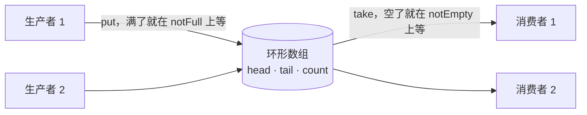

# 生产者消费者（阻塞队列）

> 非力扣原题，面试手写题 · 近两年面经：**腾讯 TEG**（线程池与生产者消费者、手写有锁和无锁消息队列）、**字节**（producer-consumer）、**美团**（生产者消费者模型）、**阿里**（多线程顺序打印）
>
> A 层：所有常见解法都要会，闭卷写出，能讲清追问

## 识别信号

「手写一个阻塞队列」「生产者消费者」「线程之间怎么协作」。核心是一个**有界缓冲区**：满了生产者等，空了消费者等。线程池的任务队列就是它。

交替打印类的题单独整理在 [1114](./lc1114)、[1115](./lc1115)、[1116](./lc1116)。

## 解法一：synchronized + wait / notifyAll

```java
class BoundedBufferMonitor<T> {
    private final Object[] items;
    private int head, tail, count;

    BoundedBufferMonitor(int cap) { items = new Object[cap]; }

    public synchronized void put(T x) throws InterruptedException {
        while (count == items.length) wait();   // 满了就等。必须用 while
        items[tail] = x;
        tail = (tail + 1) % items.length;
        count++;
        notifyAll();                             // 只有一个等待队列，要唤醒全部
    }

    @SuppressWarnings("unchecked")
    public synchronized T take() throws InterruptedException {
        while (count == 0) wait();
        T x = (T) items[head];
        items[head] = null;                      // 帮助 GC
        head = (head + 1) % items.length;
        count--;
        notifyAll();
        return x;
    }
}
```

**为什么要用 `notifyAll` 而不是 `notify`？** 生产者和消费者都在同一个等待队列里。`notify` 只唤醒一个，可能唤醒的是同类（生产者唤醒了另一个生产者），对方发现条件还是不满足又睡回去，真正需要被唤醒的消费者一直在睡，最后所有线程都在等。

## 解法二：ReentrantLock + 两个 Condition（推荐）

**思路**：「不满」和「不空」是两个条件，分开等待，就能精确唤醒对方，不会唤醒同类。

```java
class BoundedBuffer<T> {
    private final Object[] items;
    private int head, tail, count;
    private final ReentrantLock lock = new ReentrantLock();
    private final Condition notFull = lock.newCondition();
    private final Condition notEmpty = lock.newCondition();

    BoundedBuffer(int cap) { items = new Object[cap]; }

    public void put(T x) throws InterruptedException {
        lock.lock();
        try {
            while (count == items.length) notFull.await();
            items[tail] = x;
            tail = (tail + 1) % items.length;
            count++;
            notEmpty.signal();                   // 只唤醒一个消费者
        } finally {
            lock.unlock();
        }
    }

    @SuppressWarnings("unchecked")
    public T take() throws InterruptedException {
        lock.lock();
        try {
            while (count == 0) notEmpty.await();
            T x = (T) items[head];
            items[head] = null;
            head = (head + 1) % items.length;
            count--;
            notFull.signal();
            return x;
        } finally {
            lock.unlock();
        }
    }
}
```

这就是 JDK `ArrayBlockingQueue` 的实现方式。

## 解法三：Python（Condition）

```python
import threading
from collections import deque

class BoundedQueue:
    def __init__(self, cap):
        self.cap, self.q = cap, deque()
        lock = threading.Lock()
        self.not_full = threading.Condition(lock)    # 两个条件共用一把锁
        self.not_empty = threading.Condition(lock)

    def put(self, x):
        with self.not_full:
            while len(self.q) == self.cap:
                self.not_full.wait()
            self.q.append(x)
            self.not_empty.notify()

    def take(self):
        with self.not_empty:
            while not self.q:
                self.not_empty.wait()
            x = self.q.popleft()
            self.not_full.notify()
            return x
```

## 解法四：直接用现成的组件

- Java：`BlockingQueue`（`ArrayBlockingQueue`、`LinkedBlockingQueue`）的 `put` / `take`。
- Python：`queue.Queue(maxsize)`。
- 用两个信号量：`empty = Semaphore(cap)` 表示空位数，`full = Semaphore(0)` 表示元素数，再加一把锁保护队列本身。

面试时先手写解法二，最后补一句「实际项目里直接用 `BlockingQueue`」。

## 图解



以上三种实现都用 3 个生产者 × 3 个消费者、各 100 个元素测试过，没有丢失、没有重复。

## 易错点

- 用 `if` 而不是 `while` 判断条件：被唤醒后条件不一定还成立（被别的线程抢先了，或者虚假唤醒），必须重新检查。
- `wait()` / `await()` 没在持有锁时调用：会抛 `IllegalMonitorStateException`。
- `unlock()` 没放在 `finally` 里：抛异常时锁永远不释放。
- 解法一用了 `notify()`：可能所有线程都睡死。

## 面试追问

- **无锁队列怎么做？** 用 CAS 修改头尾指针（Michael-Scott 队列，JDK 的 `ConcurrentLinkedQueue`）；单生产者单消费者时可以用环形数组 + 两个 volatile 下标，不用 CAS（Disruptor 的思路）。腾讯 TEG 问过「多生产者单消费者的无锁队列」。
- **`LinkedBlockingQueue` 和 `ArrayBlockingQueue` 的区别？** 前者是链表，有两把锁（`putLock`、`takeLock`），生产和消费可以并行；后者是数组，一把锁。
- **怎么优雅停止消费者？** 放一个「毒丸」对象，消费者取到就退出；或者调用 `interrupt()`，消费者在 `take()` 上收到 `InterruptedException` 后退出。
- **消息队列（Kafka）和这个有什么关系？** 思路一样，都是用缓冲解耦生产和消费速度；MQ 把缓冲放到了独立的服务上，并持久化。

## 相关题

- [手写线程池](./thread-pool)：任务队列就是这里的阻塞队列
- [1115. 交替打印 FooBar](./lc1115)
- [1116. 打印零与奇偶数](./lc1116)
