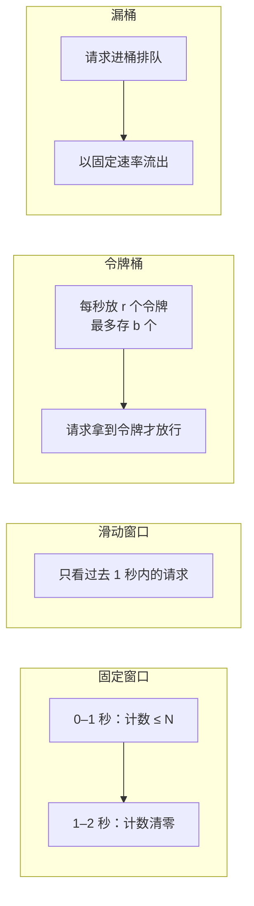

# 手写限流器（固定窗口 / 滑动窗口 / 令牌桶）

> 非力扣原题，面试手写题 · 近两年面经：**腾讯**（手撕限流器、热点限流器的内存优化）、**阿里千问**（线程安全的滑动窗口限流器）、**字节广告**（100 QPS 限流，滑动窗口和令牌桶）、**美团**（令牌桶）
>
> A 层：所有常见解法都要会，闭卷写出，能讲清追问

## 识别信号

「每秒最多 N 个请求」「保护下游」「接口防刷」。面试一般这样展开：先问你知道哪几种算法 → 让你挑一种手写 → 要求线程安全 → 问分布式怎么做。

对应的八股条目：[限流算法](https://bingqin2.github.io/bagu-notes/11-distributed/rate-limiting)。

## 四种算法对比



| 算法 | 原理 | 优点 | 缺点 |
|---|---|---|---|
| 固定窗口 | 每个时间窗口一个计数器，到了下个窗口清零 | 最简单，内存 O(1) | 临界突刺：0.9 秒来 N 个、1.1 秒再来 N 个，0.2 秒内放过了 2N 个 |
| 滑动窗口（日志） | 记下每个请求的时间戳，只统计最近一个窗口内的 | 精确 | 每个请求一个时间戳，内存 O(N) |
| 滑动窗口（分格计数） | 窗口切成 k 个小格，每格计数，统计最近 k 格 | 内存 O(k)，比固定窗口平滑 | 精度取决于格子数 |
| 令牌桶 | 按固定速率往桶里放令牌，桶满就不放；请求拿到令牌才放行 | 允许一定突发（桶里存着的令牌），长期速率受控。**最常用** | 要调两个参数 |
| 漏桶 | 请求进队列，以固定速率处理 | 输出绝对平滑 | 不允许突发，请求要排队等 |

## 解法一：固定窗口

```python
import threading, time

class FixedWindow:
    def __init__(self, limit, window=1.0):
        self.limit, self.window = limit, window
        self.start, self.count = time.monotonic(), 0
        self.lock = threading.Lock()

    def allow(self):
        with self.lock:
            now = time.monotonic()
            if now - self.start >= self.window:   # 进入新窗口，清零
                self.start, self.count = now, 0
            if self.count < self.limit:
                self.count += 1
                return True
            return False
```

## 解法二：滑动窗口（日志）

```python
from collections import deque

class SlidingLog:
    def __init__(self, limit, window=1.0):
        self.limit, self.window = limit, window
        self.log = deque()
        self.lock = threading.Lock()

    def allow(self):
        with self.lock:
            now = time.monotonic()
            while self.log and now - self.log[0] >= self.window:   # 移出窗口外的
                self.log.popleft()
            if len(self.log) < self.limit:
                self.log.append(now)
                return True
            return False
```

## 解法三：滑动窗口（分格计数）

**思路**：窗口切成 `buckets` 个小格，用环形数组存每格的计数和它对应的时间片编号。时间片编号不对就说明这格是很久以前的，清零后复用。

```python
class SlidingWindowCounter:
    def __init__(self, limit, window=1.0, buckets=10):
        self.limit, self.n = limit, buckets
        self.size = window / buckets              # 每格的时长
        self.counts = [0] * buckets
        self.stamps = [-1] * buckets              # 每格对应的时间片编号
        self.lock = threading.Lock()

    def allow(self):
        with self.lock:
            slot = int(time.monotonic() / self.size)
            i = slot % self.n
            if self.stamps[i] != slot:            # 过期的格子，清零复用
                self.stamps[i], self.counts[i] = slot, 0
            total = sum(c for c, s in zip(self.counts, self.stamps) if slot - s < self.n)
            if total < self.limit:
                self.counts[i] += 1
                return True
            return False
```

## 解法四：令牌桶（重点）

**思路**：不需要后台线程定时放令牌。每次请求来时，按「距离上次的时间 × 速率」**惰性补充**令牌，补完再判断够不够。

```python
class TokenBucket:
    def __init__(self, rate, capacity):
        self.rate, self.capacity = rate, capacity   # 每秒补 rate 个，最多存 capacity 个
        self.tokens, self.last = capacity, time.monotonic()
        self.lock = threading.Lock()

    def allow(self):
        with self.lock:
            now = time.monotonic()
            self.tokens = min(self.capacity, self.tokens + (now - self.last) * self.rate)
            self.last = now
            if self.tokens >= 1:
                self.tokens -= 1
                return True
            return False
```

### Java 版（令牌桶 + 滑动窗口）

```java
class TokenBucket {
    private final double rate;      // 每秒补充的令牌数
    private final double capacity;  // 桶容量，也就是允许的突发量
    private double tokens;
    private long lastNanos;

    TokenBucket(double rate, double capacity) {
        this.rate = rate;
        this.capacity = capacity;
        this.tokens = capacity;
        this.lastNanos = System.nanoTime();
    }

    public synchronized boolean tryAcquire() {
        long now = System.nanoTime();
        tokens = Math.min(capacity, tokens + (now - lastNanos) / 1e9 * rate);
        lastNanos = now;
        if (tokens >= 1) {
            tokens -= 1;
            return true;
        }
        return false;
    }
}

class SlidingWindowLimiter {
    private final int limit;
    private final long windowNanos;
    private final Deque<Long> log = new ArrayDeque<>();

    SlidingWindowLimiter(int limit, long windowMillis) {
        this.limit = limit;
        this.windowNanos = windowMillis * 1_000_000;
    }

    public synchronized boolean tryAcquire() {
        long now = System.nanoTime();
        while (!log.isEmpty() && now - log.peekFirst() >= windowNanos) log.pollFirst();
        if (log.size() < limit) {
            log.addLast(now);
            return true;
        }
        return false;
    }
}
```

以上 Python 和 Java 代码都跑过测试：连续请求 20 次，限额 5 时恰好放行 5 次。

## 易错点

- 用 `time.time()` / `System.currentTimeMillis()` 计时：系统时间可能被调整（回拨）。要用单调时钟 `time.monotonic()` / `System.nanoTime()`。
- 「读取 → 判断 → 修改」三步必须在同一把锁里，否则并发下会多放行。
- 令牌数用浮点数：每次只过去几毫秒，补充的令牌不到 1 个，用整数会被截断成 0。
- 令牌桶补充时要和容量取 `min`，否则空闲很久后会攒出无限多令牌。

## 面试追问

- **分布式限流怎么做？** 计数放在 Redis 里，用 Lua 脚本保证「补充 + 判断 + 扣减」原子执行，见 [Lua 与原子性](https://bingqin2.github.io/bagu-notes/07-redis/lua-atomic)。固定窗口最简单：`INCR key` + 首次设置 `EXPIRE`；滑动窗口用 ZSet（score 存时间戳，`ZREMRANGEBYSCORE` 删掉窗口外的，再 `ZCARD`）。
- **按用户或接口分别限流？** 用 `ConcurrentHashMap<String, TokenBucket>`，`computeIfAbsent` 按 key 创建。key 很多时要考虑过期清理（Caffeine 缓存限流器对象），这就是腾讯问的「热点限流器内存优化」。
- **限流后怎么处理请求？** 直接拒绝（返回 429）、排队等待（令牌桶可以计算出要等多久）、降级返回兜底数据。
- **大模型接口的 RPM / TPM 限流？** 两个桶：一个按请求数，一个按 token 数。请求前按预估的 token 数预扣，返回后按实际用量多退少补。字节广告问过「token 预扣」。
- **现成的工具？** 单机用 Guava `RateLimiter`（令牌桶，支持预热）；服务治理用 Sentinel（滑动窗口，支持热点参数限流）。

## 相关题

- [146. LRU 缓存](./lc146)：同样是「手写一个带并发的组件」
- [singleflight](./singleflight)
- [手写线程池](./thread-pool)
