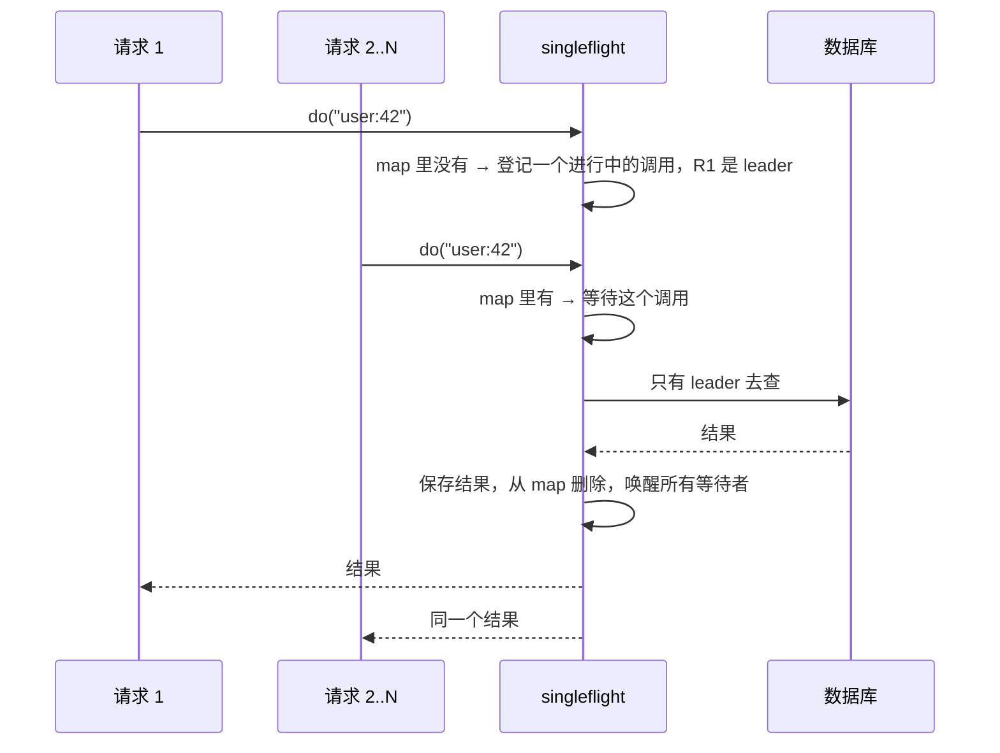

# singleflight（合并相同请求）

> 非力扣原题，面试手写题 · 近两年面经：**字节**（抖音平台后端一面手撕 singleflight）、**腾讯 WXG**（项目深挖里问到 single-flight）
>
> A 层：所有常见解法都要会，闭卷写出，能讲清追问

## 识别信号

「同一时刻有很多请求查同一个 key，只让一个去查数据库，其他的等它的结果」。这是缓存击穿的标准解法，Go 标准扩展库 `golang.org/x/sync/singleflight` 就是这个名字的来源。

对应的八股条目：[缓存穿透、击穿、雪崩](https://bingqin2.github.io/bagu-notes/07-redis/cache-problems)。

## 思路



数据结构：`map[key] → 进行中的调用`。一个调用对象里有：结果、异常、一个「完成」信号。

## 解法一：Python（锁 + Event）

```python
import threading

class _Call:
    def __init__(self):
        self.done = threading.Event()
        self.val = self.err = None

class SingleFlight:
    def __init__(self):
        self.lock = threading.Lock()
        self.calls = {}

    def do(self, key, fn):
        with self.lock:
            c = self.calls.get(key)
            leader = c is None
            if leader:
                c = self.calls[key] = _Call()
        if not leader:
            c.done.wait()                    # 等 leader 的结果
        else:
            try:
                c.val = fn()
            except Exception as e:
                c.err = e
            finally:
                with self.lock:
                    del self.calls[key]      # 结束后删除，下一批请求会重新查
                c.done.set()                 # 唤醒所有等待者
        if c.err:
            raise c.err
        return c.val
```

测试：50 个线程同时 `do("k", 慢查询)`，慢查询只执行了 1 次，50 个线程都拿到了结果。

## 解法二：Java（ConcurrentHashMap + CompletableFuture）

**思路**：`putIfAbsent` 原子地判断「有没有人在查」。放成功的就是 leader，其他线程拿到已有的 Future，`join()` 等结果。

```java
class SingleFlight<K, V> {
    private final ConcurrentHashMap<K, CompletableFuture<V>> calls = new ConcurrentHashMap<>();

    public V doCall(K key, Supplier<V> loader) {
        CompletableFuture<V> mine = new CompletableFuture<>();
        CompletableFuture<V> existing = calls.putIfAbsent(key, mine);
        if (existing != null) return existing.join();   // 已经有人在查，等它
        try {
            V v = loader.get();
            mine.complete(v);
            return v;
        } catch (RuntimeException e) {
            mine.completeExceptionally(e);              // 等待者也会收到异常
            throw e;
        } finally {
            calls.remove(key, mine);                    // 只删自己放进去的那个
        }
    }
}
```

**为什么不直接用 `computeIfAbsent(key, k -> loader.get())`？** `computeIfAbsent` 执行函数期间会锁住这个桶，慢查询会阻塞同一个桶上其他 key 的操作；而且函数里不能再修改这个 Map。所以只用它放一个 Future，真正的查询在锁外面做。

## 易错点

- 结果返回后忘记从 map 里删除：之后的请求永远拿到旧结果，singleflight 就变成了一个永不过期的缓存。
- 删除时用 `remove(key)` 而不是 `remove(key, mine)`：极端情况下可能删掉下一批请求刚放进去的调用。
- leader 抛异常时没有通知等待者，等待者会永远阻塞。
- 判断「有没有人在查」和「登记自己」不是原子的，两个请求都会成为 leader。

## 面试追问

- **和缓存是什么关系？** singleflight 只合并**同一时刻**的重复请求，结果不保存；缓存保存结果一段时间。它们一起用：缓存没命中时，用 singleflight 回源。
- **leader 查得很慢怎么办？** 等待者加超时（`orTimeout` / `Event.wait(timeout)`），超时就返回旧值或降级结果。Go 的版本还提供 `Forget(key)`，让后续请求不再等这个慢调用。
- **分布式环境下呢？** singleflight 只能合并单机内的请求，N 台机器最多还是有 N 个请求回源。要全局只有一个，就用 [Redis 分布式锁](https://bingqin2.github.io/bagu-notes/07-redis/distributed-lock)，或者接受 N 个（通常已经够少了）。
- **和互斥锁方案有什么区别？** 互斥锁方案里，没拿到锁的请求要不断重试读缓存；singleflight 的等待者直接拿到 leader 的结果，不需要再读一次缓存。

## 相关题

- [146. LRU 缓存](./lc146)
- [手写限流器](./rate-limiter)
