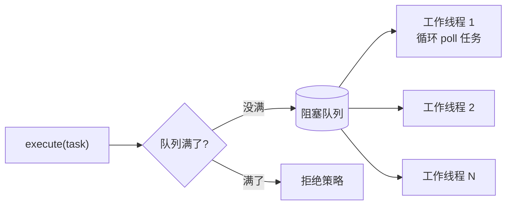

# 手写线程池

> 非力扣原题，面试手写题 · 近两年面经：**京东零售**（手撕线程池）、**小红书**（手写线程池）、**字节**（阅读线程池代码找问题）
>
> A 层：所有常见解法都要会，闭卷写出，能讲清追问

## 识别信号

「实现一个简化版的 ThreadPoolExecutor」。考的是：阻塞队列、工作线程循环取任务、拒绝策略、异常隔离、优雅关闭。

对应的八股条目：[线程池](https://bingqin2.github.io/bagu-notes/03-concurrency/thread-pool)、[线程池实战](https://bingqin2.github.io/bagu-notes/03-concurrency/thread-pool-practice)。

## 结构



## 解法一：固定线程数（面试最常写的版本）

```java
class SimpleThreadPool {
    private final BlockingQueue<Runnable> queue;
    private final List<Thread> workers = new ArrayList<>();
    private volatile boolean shutdown = false;

    SimpleThreadPool(int nThreads, int queueSize) {
        queue = new ArrayBlockingQueue<>(queueSize);       // 有界队列，防止 OOM
        for (int i = 0; i < nThreads; i++) {
            Thread t = new Thread(this::runWorker, "pool-worker-" + i);  // 线程起名字，方便排查
            workers.add(t);
            t.start();
        }
    }

    private void runWorker() {
        while (true) {
            Runnable task;
            try {
                if (shutdown && queue.isEmpty()) return;   // 关闭后，把队列里的任务做完再退出
                task = queue.poll(100, TimeUnit.MILLISECONDS);
            } catch (InterruptedException e) {
                return;
            }
            if (task == null) continue;
            try {
                task.run();
            } catch (RuntimeException e) {                 // 一个任务失败不能让工作线程退出
                System.err.println("task failed: " + e);
            }
        }
    }

    public void execute(Runnable task) {
        if (shutdown) throw new RejectedExecutionException("pool is shut down");
        if (!queue.offer(task))                            // offer 不阻塞，满了返回 false
            throw new RejectedExecutionException("queue is full");   // 拒绝策略：抛异常
    }

    public void shutdown() throws InterruptedException {
        shutdown = true;
        for (Thread t : workers) t.join();
    }
}
```

**为什么用 `poll(超时)` 而不是 `take()`？** `take()` 会一直阻塞，关闭时工作线程醒不过来。用带超时的 `poll`，每隔一段时间检查一次关闭标志。另一种做法是关闭时往队列里放 N 个「毒丸」任务，工作线程取到就退出（Python 版就是这么做的）。

## 解法二：Python 版（毒丸关闭）

```python
import queue, threading

class RejectedError(Exception):
    pass

class SimpleThreadPool:
    def __init__(self, workers, queue_size):
        self.tasks = queue.Queue(queue_size)
        self.shutdown_flag = False
        self.threads = [threading.Thread(target=self._worker, daemon=True) for _ in range(workers)]
        for t in self.threads:
            t.start()

    def _worker(self):
        while True:
            task = self.tasks.get()
            if task is None:                  # 毒丸：收到就退出
                return
            fn, args = task
            try:
                fn(*args)
            except Exception as e:            # 一个任务出错不能让工作线程退出
                print("task failed:", e)

    def submit(self, fn, *args):
        if self.shutdown_flag:
            raise RejectedError("pool is shut down")
        try:
            self.tasks.put_nowait((fn, args))
        except queue.Full:
            raise RejectedError("queue is full")

    def shutdown(self):
        self.shutdown_flag = True
        for _ in self.threads:
            self.tasks.put(None)              # 每个线程一个毒丸，排在已有任务后面
        for t in self.threads:
            t.join()
```

两个版本都测试过：提交 50 个任务和 1 个会抛异常的任务，50 个全部执行，异常没有影响其他任务，关闭后再提交会被拒绝。

## 解法三：加上核心线程和最大线程（追问时再讲）

在解法一的基础上，按 JDK 的规则扩展 `execute`：

1. 线程数 < 核心线程数：新建线程，这个任务直接交给它。
2. 否则 `queue.offer`，成功就返回。
3. 失败且线程数 < 最大线程数：新建非核心线程执行。
4. 否则拒绝。

非核心线程在 `poll(keepAliveTime)` 返回 null（空闲超时）时退出。线程数要用 `AtomicInteger` 维护，判断和新建线程要加锁或用 CAS。说清楚这些步骤即可，现场写全一般不要求。

## 易错点

- 任务异常没有 catch：工作线程直接死掉，线程池越来越小。
- 用无界队列：任务堆积时 OOM，拒绝策略形同虚设。
- `shutdown` 标志没有 `volatile`：工作线程可能一直看不到。
- 关闭时直接中断线程，队列里没执行的任务丢了，也没告诉调用方。

## 面试追问

- **怎么支持返回值？** 提交时把 `Callable` 包装成 `FutureTask`（它本身是 Runnable），返回给调用方，调用方 `get()` 等结果。
- **拒绝策略做成可配置？** 定义一个接口 `RejectPolicy.reject(task, pool)`，内置抛异常、调用者执行（`task.run()`）、丢弃、丢弃最老的（`queue.poll()` 再 `offer`）四种实现。
- **和 JDK 的实现比还差什么？** 线程数和状态的原子管理（`ctl`）、核心线程预热、`allowCoreThreadTimeOut`、`beforeExecute` / `afterExecute` 钩子、`shutdownNow` 返回未执行的任务、Worker 自身继承 AQS 用来判断是否空闲。
- **怎么测试线程池？** 提交大量任务验证都执行了；提交抛异常的任务验证不影响其他任务；队列满时验证拒绝；关闭后验证拒绝且已提交的任务都完成。

## 相关题

- [生产者消费者](./producer-consumer)：任务队列就是阻塞队列
- [手写限流器](./rate-limiter)
